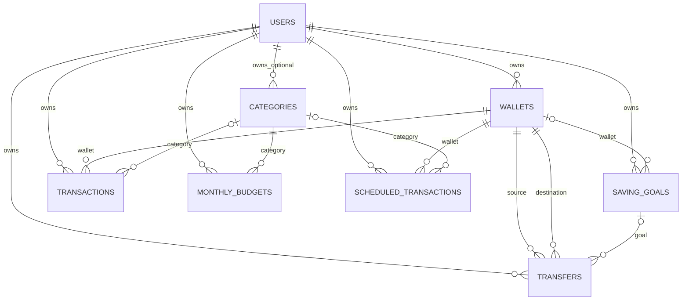
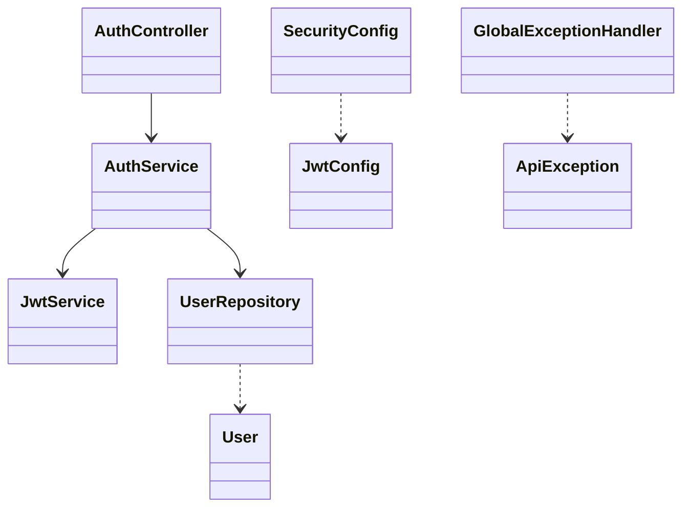
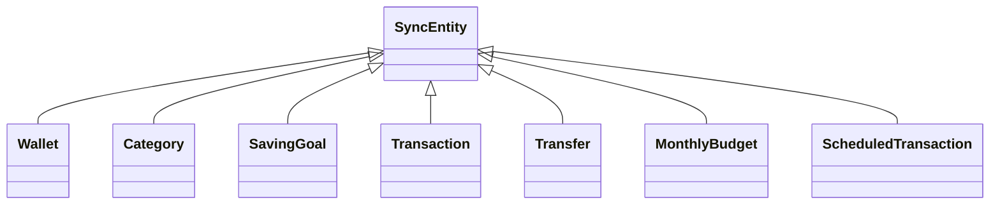
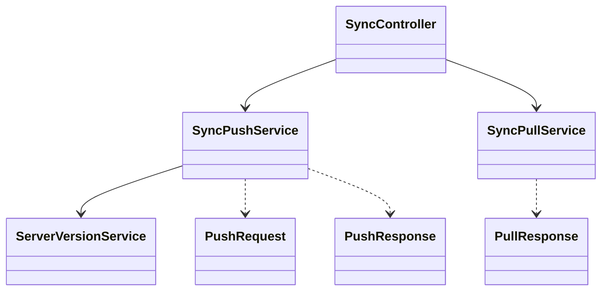
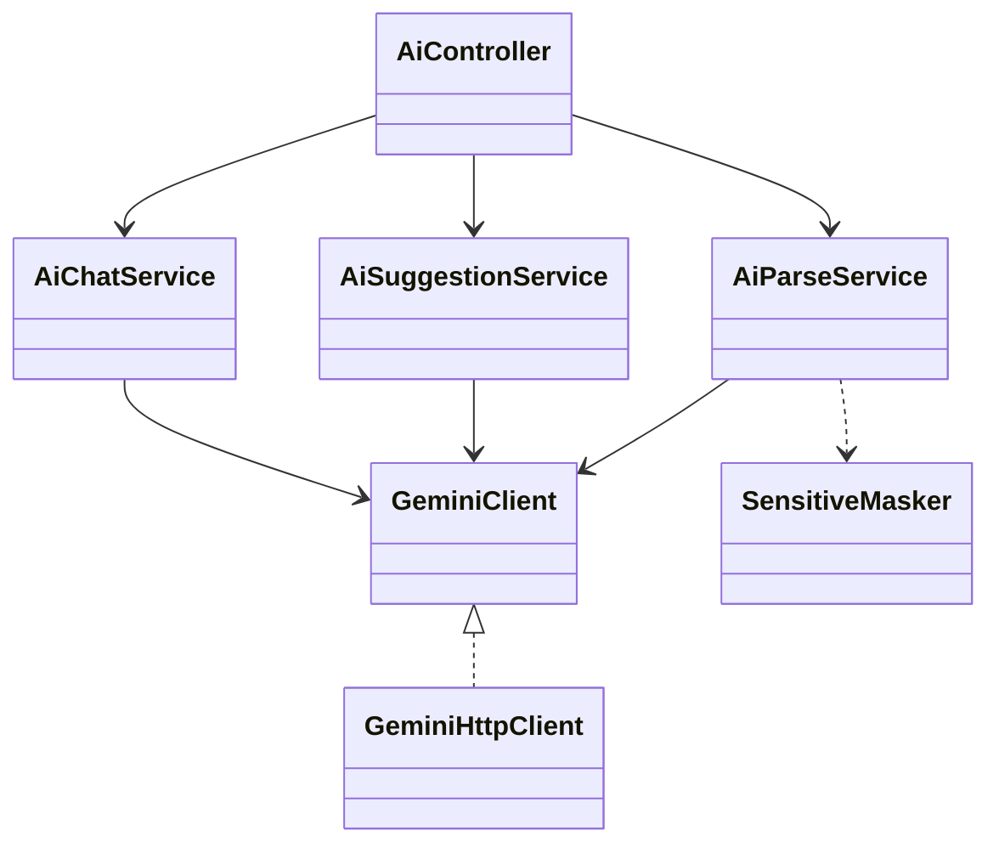
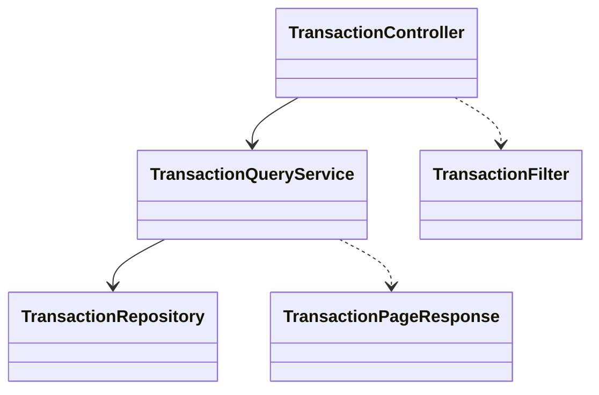

# Rà soát Backend và Database SQL Server

> Phạm vi: `backend/` và `docs/api/openapi.yaml`. Nguồn sự thật là Java source và migration SQL; dẫn chứng đường dẫn tương đối từ repo kèm dòng. Không công bố bí mật. Snapshot rà soát 05/11/2026.

## A1. Tổng quan kỹ thuật

### Build/dependency

| Dependency | Version thực tế | Vai trò | Evidence |
|---|---|---|---|
| `org.springframework.boot:spring-boot-starter-parent` | 4.1.1 | parent/BOM | `backend/pom.xml:5-9` |
| `org.springframework.boot:spring-boot-starter-webmvc` | parent-managed | REST MVC | `pom.xml:21-23` |
| `org.springframework.boot:spring-boot-starter-security` | parent-managed | Security | `pom.xml:22-24` |
| `org.springframework.boot:spring-boot-starter-oauth2-resource-server` | parent-managed | JWT resource server | `pom.xml:23-25` |
| `org.springframework.boot:spring-boot-starter-data-jpa` | parent-managed | JPA | `pom.xml:24-26` |
| `org.springframework.boot:spring-boot-starter-validation` | parent-managed | validation | `pom.xml:25-27` |
| `org.springframework.boot:spring-boot-starter-flyway`, `org.flywaydb:flyway-sqlserver` | parent-managed | migrations | `pom.xml:26-29` |
| `com.microsoft.sqlserver:mssql-jdbc` | 13.6.0.jre11 | SQL Server JDBC | `pom.xml:15-19,29` |
| `org.springdoc:springdoc-openapi-starter-webmvc-ui` | 3.1.1 | OpenAPI/Swagger | `pom.xml:16-18,30` |
| `org.springframework.boot:*test` (JPA, security, validation, webmvc) | parent-managed, test | test support | `pom.xml:31-35` |
| `org.projectlombok:lombok` | 1.18.46, optional | annotation processor | `pom.xml:18-19,35,39-42` |

Java target 17 (`pom.xml:15-17`); Spring Boot 4.1.1; Maven Wrapper (`backend/mvnw.cmd`); artifact `com.pfm:backend:0.0.1-SNAPSHOT` (`pom.xml:11-13`). Test log dùng JDK 25.0.4.1, khác target.

### Package thực tế

| Package dưới `com.pfm.backend` | Vai trò |
|---|---|
| gốc | bootstrap `BackendApplication` |
| `auth`, `auth.dto` | đăng ký, đăng nhập, User/JWT, DTO |
| `config` | Security filter chain và JWT encoder/decoder |
| `common` | ApiException, global exception mapping |
| `sync`, `.dto`, `.entity`, `.repo` | push/pull, version, DTO, entity/repository đồng bộ |
| `transaction`, `.dto` | lọc/phân trang giao dịch |
| `ai`, `.dto` | Gemini, parse, suggestions, chat, masking, DTO |

Căn cứ package declarations và cây `backend/src/main/java/com/pfm/backend/`; class/method cụ thể ở A3, A8.

### Cấu hình

| Key | Giá trị không nhạy cảm / biến |
|---|---|
| `spring.application.name` | `backend` |
| `spring.datasource.url/username/password` | `${DB_URL}`, `${DB_USER}`, `${DB_PASSWORD}` |
| `spring.jpa.hibernate.ddl-auto` | `none` |
| `spring.jpa.open-in-view` | `false` |
| `spring.jpa.properties.hibernate.jdbc.time_zone` | `UTC` |
| `spring.jpa.properties.hibernate.type.preferred_instant_jdbc_type` | `TIMESTAMP` |
| `spring.jackson.property-naming-strategy` | `SNAKE_CASE` |
| `spring.flyway.enabled` | `true` |
| `app.jwt.secret` | `${JWT_SECRET}` (không ghi giá trị) |
| `app.jwt.expires-days` | `7` |
| `app.gemini.api-key` | `GEMINI_API_KEY`, mặc định rỗng |
| `app.gemini.model` | `GEMINI_MODEL`, mặc định `gemini-3.1-flash-lite` |
| `app.gemini.base-url` | `https://generativelanguage.googleapis.com/v1beta` |
| `app.gemini.fallback-model` | `GEMINI_FALLBACK_MODEL`, mặc định `gemini-3.5-flash-lite` |
| `app.gemini.timeout-seconds` | `15` |

Nguồn: `backend/src/main/resources/application.yml:3-31`. Test profile chỉ override `spring.datasource.url: ${TEST_DB_URL}` (`backend/src/test/resources/application-test.yml:3-5`).

## A2. Bảo mật

| Nội dung | Hiện trạng và bằng chứng |
|---|---|
| Public | `/auth/**`, `/error`, `/v3/api-docs/**`, `/swagger-ui/**`, `/swagger-ui.html`; `SecurityConfig.filterChain`, `backend/src/main/java/com/pfm/backend/config/SecurityConfig.java:25-35` |
| JWT required | mọi route khác qua `anyRequest().authenticated()`; gồm sync, transaction, AI. |
| Session/CSRF | `STATELESS`; CSRF disabled (`SecurityConfig.java:26-28`) |
| CORS | KHÔNG TÌM THẤY cấu hình CORS tường minh trong backend. |
| JWT | HMAC HS256; subject=user UUID, claims `iat`, `exp`; mặc định 7 ngày (`config/JwtConfig.java:19-31`; `auth/JwtService.java:24-32`; `application.yml:22-25`) |
| Filter | OAuth2 Resource Server filter của Spring, không có custom JWT filter (`SecurityConfig.java:32-34`) |
| User ID | controller lấy từ `jwt.getSubject()`; ví dụ `transaction/TransactionController.java:23-36`, `ai/AiController.java:40-48`, `sync/SyncController.java`. Register nhận `id` client để tạo tài khoản, không phải quyền chọn user khi truy cập dữ liệu. |
| Password/email | `BCryptPasswordEncoder`, `encode`/`matches` (`SecurityConfig.java:19-22`; `auth/AuthService.java:37-46`). Email trim/lowercase `Locale.ROOT` (`AuthService.java:28-30,42-45`). |

Error shape `{code,message}` (`common/GlobalExceptionHandler.java:11-14`); entry point JWT cũng cùng shape (`SecurityConfig.java:38-43`).

| Exception/điều kiện | HTTP | Code | Evidence |
|---|---:|---|---|
| `ApiException` | status trong exception | exception code | `GlobalExceptionHandler.java:16-19` |
| Bean validation | 400 | `VALIDATION_FAILED` | `:21-26` |
| JSON body không đọc được | 400 | `VALIDATION_FAILED` | `:28-31` |
| Query type mismatch | 400 | `VALIDATION_FAILED` | `:33-37` |
| `DataIntegrityViolationException` | 409 | `EMAIL_ALREADY_EXISTS` | `:39-42` (cũng áp cho constraint không liên quan email) |
| thiếu/sai/hết JWT | 401 | `UNAUTHORIZED` | `SecurityConfig.java:38-43` |
| sai credential | 401 | `INVALID_CREDENTIALS` | `auth/AuthService.java:42-52` |

## A3. Danh mục API

Rule bảo mật áp dụng từ `SecurityConfig.java:28-34`; Jackson chuyển snake_case (`application.yml:17-18`).

| Method + path | JWT | Controller → service/repository | Request/response chính | Lỗi chính |
|---|---|---|---|---|
| `POST /auth/register` | Không | `AuthController.register` → `AuthService.register` → `UserRepository`, `JwtService.issue` (`auth/AuthController.java:23-27`; `AuthService.java:27-40`) | Request: `id` UUID; `full_name` 1..100; email; password 6..72. Response `token,user{id,full_name,email}`. Schema `docs/api/openapi.yaml` RegisterRequest/AuthResponse. Ví dụ `{"id":"<uuid>","full_name":"An","email":"an@example.test","password":"<đã che>"}` → `{"token":"<đã che>","user":{"id":"<uuid>","full_name":"An","email":"an@example.test"}}` (schema, không phải literal fixture). | 400 `VALIDATION_FAILED`; 409 `EMAIL_ALREADY_EXISTS`/`ID_ALREADY_EXISTS` |
| `POST /auth/login` | Không | `AuthController.login` → `AuthService.login` → `UserRepository.findByEmailAndDeletedFalse`, BCrypt, JWT (`AuthController.java:29-32`; `AuthService.java:42-47`) | `{email,password}` → cùng `AuthResponse`; schema OpenAPI LoginRequest. | 400 validation; 401 `INVALID_CREDENTIALS` |
| `POST /sync/push` | Có | `SyncController.push` → `SyncPushService.push` → repository theo bảng (`sync/SyncPushService.java:69-85`) | `records` gồm 7 arrays; tối đa 500 records. Response `results[{table,id,status,reason,message}]`. OpenAPI PushRequest/PushResponse; ví dụ `{ "records":{"wallets":[]} }` → `{"results":[]}`. | 400 validation/batch; per-record reject trả 200; 401 |
| `GET /sync/pull` | Có | `SyncController.pull` → `SyncPullService.pull` → 7 repositories (`sync/SyncPullService.java:47-80`) | `cursor>=0` default 0; `limit` 1..500 default 500. Response `changes,next_cursor,has_more`; ví dụ các collection rỗng, cursor 0. | 400 `VALIDATION_FAILED`; 401 |
| `GET /transactions` | Có | `TransactionController.list` → `TransactionQueryService.search` → `TransactionRepository.findAll` (`transaction/TransactionController.java:23-37`; `TransactionQueryService.java:38-44`) | Params: `q` max100; `type`; `wallet_id`,`category_id`; `from`,`to`; `min_amount`,`max_amount`; `page` default0; `size` default20. Response items/page/size/total_elements/total_pages. | 400 `VALIDATION_FAILED`; 401 |
| `POST /ai/parse-text` | Có (default) | `AiController.parseText` → `AiParseService.parse` → masker → Gemini (`ai/AiController.java:30-33`; `AiParseService.java:73-85`) | items 1..10, ref 1..100, source SMS/TEXT, content 1..1000; categories max100. Response results status PARSED/NOT_A_TRANSACTION/FAILED. | 400; Gemini 429 `AI_RATE_LIMITED`, 503 `AI_UNAVAILABLE`; 401 |
| `POST /ai/parse-image` | Có (default) | `AiController.parseImage` → `AiParseService.parseImage` → Gemini (`AiController.java:35-38`; `AiParseService.java:88-112`) | image_base64, MIME JPEG/PNG/WEBP, categories max100, decoded image <=3MiB. Response status + suggestion. | 400; 429/503; 401 |
| `POST /ai/suggestions` | Có | `AiController.suggest` → `AiSuggestionService.suggest` → repositories/Gemini (`AiController.java:40-43`) | `{period_type:WEEK\|MONTH}` → status, period dates, content, data, message. | 400; 429/503; 401 |
| `POST /ai/chat` | Có | `AiController.chat` → `AiChatService.chat` → repos/Gemini (`AiController.java:45-48`; `AiChatService.java:65-133`) | messages 1..6; USER/ASSISTANT; content 1..500. Response status/reply/message. | 400; 429/503; 401 |

OpenAPI khai báo 9 operation, tương ứng 9 mapping trên; `openapi: 3.1.0` (`docs/api/openapi.yaml`). Auth có `security: []`; global bearer. Parse-text/image không có override nên JWT. SecurityConfig public thêm error/docs/swagger. OpenAPI AI responses chưa mô tả hết 429/503. Không thấy endpoint thiếu/thừa sau đối chiếu. JSON mẫu chi tiết nằm trong schema OpenAPI; response động phụ thuộc DB/AI.

## A4. Database SQL Server

| Table | Columns (SQL type; NULL nếu ghi) | PK/FK/UNIQUE/CHECK/DEFAULT/index |
|---|---|---|
| `users` | id UNIQUEIDENTIFIER; full_name NVARCHAR(100); email NVARCHAR(255); password_hash NVARCHAR(100); monthly_income BIGINT NULL; created_at,updated_at DATETIME2(3); is_deleted BIT | PK id; UNIQUE email; default UTC created/updated, deleted=0. `V1__init.sql:3-12` |
| `wallets` | id,user_id UNIQUEIDENTIFIER; wallet_name NVARCHAR(100); wallet_type NVARCHAR(50); opening_balance BIGINT; color NVARCHAR(20) NULL; icon NVARCHAR(50) NULL; updated_at DATETIME2(3); is_deleted BIT; server_version BIGINT | PK; FK user; DEFAULT opening=0/deleted=0; index `(user_id,server_version)`. `V1:14-25,94` |
| `categories` | id UNIQUEIDENTIFIER; user_id UNIQUEIDENTIFIER NULL; category_name NVARCHAR(100); type VARCHAR(10); color NVARCHAR(20) NULL; icon NVARCHAR(50) NULL; updated_at DATETIME2(3); is_deleted BIT; server_version BIGINT | PK; FK user; CHECK type; deleted=0; pull index. `V1:27-37,95` |
| `saving_goals` | id,user_id UNIQUEIDENTIFIER; wallet_id UNIQUEIDENTIFIER NULL; goal_name NVARCHAR(100); target_amount BIGINT; expected_completion_date DATE NULL; status VARCHAR(20); updated_at DATETIME2(3); deleted BIT; version BIGINT | PK; FK user/wallet; CHECK target>0; DEFAULT status IN_PROGRESS/deleted=0; pull index. `V1:39-50,96` |
| `transactions` | id,user_id,wallet_id UNIQUEIDENTIFIER; category_id UNIQUEIDENTIFIER NULL; type VARCHAR(10); amount BIGINT; note NVARCHAR(500) NULL; source VARCHAR(10); transaction_date DATE; created_at,updated_at DATETIME2(3); deleted BIT; version BIGINT | PK; FK user/wallet/category; CHECK type, amount>0, source; DEFAULT source MANUAL, created UTC, deleted=0; pull index. `V1:52-66,97` |
| `transfers` | id,user_id,source_wallet_id,destination_wallet_id UNIQUEIDENTIFIER; goal_id UNIQUEIDENTIFIER NULL; amount BIGINT; transfer_date DATE; note NVARCHAR(500) NULL; updated_at DATETIME2(3); deleted BIT; version BIGINT | PK; FK user/wallets/goal; CHECK amount>0; deleted=0; pull index. `V1:68-80,98` |
| `monthly_budgets` | id,user_id,category_id UNIQUEIDENTIFIER; month CHAR(7); spending_limit BIGINT; updated_at DATETIME2(3); deleted BIT; version BIGINT | PK; FK user/category; CHECK limit>0; deleted=0; pull index; filtered UNIQUE active `(user_id,category_id,month)`. `V1:82-101` |
| `scheduled_transactions` | id,user_id,wallet_id UNIQUEIDENTIFIER; category_id UNIQUEIDENTIFIER NULL; type VARCHAR(10); amount BIGINT; note NVARCHAR(500) NULL; start_date DATE; time_of_day CHAR(5); repeat_unit VARCHAR(10) NULL; repeat_every INT NULL; end_date,next_due_date DATE NULL; updated_at DATETIME2(3); deleted BIT; version BIGINT | PK; FK user/wallet/category; CHECK type/amount/repeat unit/every and pair nullability; deleted=0; pull index. `V3__scheduled_transactions.sql:1-22` |

Các cột không đánh dấu NULL là NOT NULL. V1 tạo global sequence `seq_server_version` start 1 (`V1:1`). Không khai báo ON DELETE tường minh nên FK dùng NO ACTION mặc định SQL Server; sync dùng soft delete. V2 thêm `ix_tx_user_date(user_id,is_deleted,transaction_date DESC)` (`V2:1`).

Entity mapping: `User→users` (`auth/User.java`); `Wallet`, `Category`, `SavingGoal`, `Transaction`, `Transfer`, `MonthlyBudget` → tên bảng snake_case tương ứng; `ScheduledTransaction→scheduled_transactions` (`sync/entity/*.java`). `SyncEntity` giữ id/userId/updatedAt/deleted/serverVersion (`sync/entity/SyncEntity.java`). UUID Java ↔ UNIQUEIDENTIFIER; server_version từ sequence; updated_at push từ client sau clamp; transaction created_at do server gán khi mới; is_deleted là tombstone. Users timestamps có UTC default, entity sync khác updated_at do backend ghi. V1/V3 không tạo `pending_transactions`, `ai_suggestions`, `sync_queue`, và backend không có entity/repo cho chúng; lý do phía kiến trúc client: CHƯA XÁC MINH.

Quan hệ: User 1-N tất cả dữ liệu sở hữu; category user nullable (NULL là system category); Wallet 1-N goal/transaction/scheduled và 1-N transfer ở cả hai vai; Category 1-N transaction/budget/scheduled; SavingGoal 1-N transfers. Xóa hard bị FK NO ACTION; soft delete qua flag.

## A5. Cơ chế đồng bộ phía server

Push order: wallets → categories → saving_goals → transactions → transfers → monthly_budgets → scheduled_transactions (`sync/SyncPushService.java:69-85`). Tổng batch max 500; từng record chạy TransactionTemplate và constraint/IllegalArgumentException thành INVALID (`:73-110`). `gate` kiểm uid, user_id body nếu có phải trùng, ownership bản ghi hiện hữu, updated_at bắt buộc; updated_at không mới hơn hiện tại → SKIPPED_NEWER (`:133-143`). Timestamp > now+5m bị clamp về now; millis precision (`:114-117`). APPLIED/SKIPPED_NEWER/REJECTED, reasons INVALID/PARENT_DELETED/FUTURE_DATE (`sync/dto/PushStatus.java`, `RejectReason.java`; `SyncPushService` push methods). Parent ownership/state được check trước ghi; future transaction/transfer dates bị reject. Budget được gộp theo user/category/month ở `pushBudget`; filtered unique index ngăn duplicate active. Soft delete; không sync current_balance/saved_amount; không kiểm tra số dư (DTO/migration/OpenAPI).

Pull kiểm cursor>=0, limit 1..500; mỗi repo lọc uid và server_version>cursor, lấy limit+1; merge versions, sort, cutoff, `has_more`, cắt từng collection (`sync/SyncPullService.java:47-90`). Cursor dùng chung, sequence lấy qua `SELECT NEXT VALUE FOR seq_server_version` (`sync/ServerVersionService.java:12-17`). Categories hệ thống user_id NULL không khớp filter uid nên không trả pull. Sequence allocation trước commit có thể đảo thứ tự quan sát giữa push đồng thời; không thấy lock/commit-order guarantee hay kiểm thử được dẫn chứng: CHƯA XÁC MINH cách khắc phục.

## A6. AI backend

| Feature | Luồng, dữ liệu gửi | Trạng thái và hậu kiểm |
|---|---|---|
| parse-text | Validate refs; mask nội dung; gửi ngày VN, categories, tối đa 10 item trong prompt (`ai/AiParseService.java:73-85,141-149`). Không có balances/notes server/transfers. | Sai JSON, thiếu field, amount không nguyên/dương/>1e12 hoặc type sai → FAILED; is_transaction false → NOT_A_TRANSACTION; category chỉ nhận UUID request có type khớp; note trim/cắt 80; confidence clamp 0..1; missing/invalid/future date thành hôm nay (`:170-212`). |
| parse-image | Base64 decode, 1..3MiB, kiểm header JPEG/PNG/WEBP; gửi image inline + categories (`:88-112,129-138`). Không lấy balances/transfers DB. | is_transaction false/parsed/failed; hậu kiểm tương tự; AI note được mask thêm. Schema is_transaction, amount, type, date, note, category_id, confidence (`:51-59`). |
| suggestions | Backend đọc giao dịch, tính tổng/trung bình/top category/trend; MONTH có ngân sách; Gemini nhận số liệu aggregate, không notes, số dư ví hoặc transfer (`ai/AiSuggestionService.java`, vùng build prompt). | Không đủ dữ liệu trả INSUFFICIENT_DATA; nếu đủ, JSON lines/content làm sạch bullet, rỗng, tối đa 5 và cắt max length. |
| chat | Last message phải USER; đọc tx trong 3 tháng, tối thiểu 5; gửi monthly income/expense/top 5 categories/budget và sanitized history/question (`ai/AiChatService.java:65-132`). Không gửi notes, transfer, balance. | <5 → INSUFFICIENT_DATA; output `{reply}`, blank/sai schema → 503; bỏ `**`, trim, max 1500 (`:135-152`). System prompt yêu cầu 600 chars (`:36-46`). |

Prompt parse nhấn mạnh nội dung không tin cậy, loại OTP/quảng cáo, amount không phải số dư, ngày không suy đoán, category cùng type (`AiParseService.java:26-50`). Response schema JSON được khai báo trong AiParseService/GeminiHttpClient. Suggestions/chat prompts hạn chế phạm vi lời khuyên và chỉ dùng số tổng hợp (`AiSuggestionService.java`, `AiChatService.java:36-46`).

SensitiveMasker regex: balance `\b(?:số dư|so du|sd|balance)...`; account label `(stk|tk|a/c|acc)` + >=6 digits; card 4 nhóm 4 số; phone `+84|84|0` + 9 số; long digit sequence 10-19; partial masked `[*xX]{2,}\d{2,}` (`ai/SensitiveMasker.java:7-26`). Ví dụ input/output đã xác minh từ test: CHƯA XÁC MINH. Parse-image gửi ảnh thô sang Gemini; mask áp dụng sau cho note.

Gemini model defaults tại `application.yml:26-31`; connect timeout 5s/read timeout 15s; fallback policy gọi main tối đa hai lần rồi fallback, sleep 1s giữa lần lỗi `AI_UNAVAILABLE` (`GeminiHttpClient.java:33-44,67-89`). 429 → `AI_RATE_LIMITED`; HTTP khác, timeout/RestClientException, thiếu key → `AI_UNAVAILABLE` 503 (`:63-65,105-130`). 429 không retry do code khác. Chat max 6 messages x 500 chars (OpenAPI/DTO), min 5 tx in 3 months (`AiChatService.java:30-33,72-78`). Parse text max 10 x 1000; image 3MiB; MIME JPEG/PNG/WEBP. Suggestions period WEEK/MONTH và window thresholds nằm trong `AiSuggestionService`; con số cụ thể chưa trích đầy đủ: CHƯA XÁC MINH.

## A7. Truy vấn giao dịch

Filter: `q,type,walletId,categoryId,from,to,minAmount,maxAmount` (`transaction/TransactionFilter.java:6-7`); params snake_case tại `TransactionController.java:23-34`. Page 0-based, size 1..100 (default 20); sort transactionDate DESC, createdAt DESC, id DESC (`TransactionQueryService.java:26-30,46-64`). Luôn filter uid từ JWT và deleted=false; q LIKE trên note, case-insensitive, escape wildcard (`:70-100`). V2 index `(user_id,is_deleted,transaction_date DESC)` phục vụ lọc user/deleted và ngày sort (`V2__tx_search_index.sql:1`).

## A8. Class inventory / diagram

| Nhóm class | Package/stereotype | Field/method/phụ thuộc tiêu biểu |
|---|---|---|
| Auth/config/common | `AuthController` Controller: `service`; register/login. `AuthService` Service: users/encoder/jwt; register/login. `JwtService` Service: encoder/expiresDays; issue(UUID). `User` Entity; `UserRepository` Repository. `SecurityConfig`,`JwtConfig` Config. `ApiException`,`GlobalExceptionHandler` common. | Constructor injection; source `auth/*.java`, `config/*.java`, `common/*.java`; JWT config cụ thể A2. |
| Sync entities/repos | `SyncEntity` Entity base: id,userId,updatedAt,deleted,serverVersion; 7 entity con Wallet/Category/SavingGoal/Transaction/Transfer/MonthlyBudget/ScheduledTransaction. 7 Repository tương ứng. | entities extend SyncEntity; repo extends Spring Data JPA interfaces. `sync/entity/*.java`, `sync/repo/*.java`. |
| Sync services/controller/DTO | SyncController, SyncPushService, SyncPullService, ServerVersionService; PushRequest/Response/Result/Status/RejectReason, PullResponse và record DTO. | Controller inject push/pull; push inject repos/version; pull inject repos. `sync/*.java`, `sync/dto/*.java`. |
| AI | AiController, AiParseService, AiSuggestionService, AiChatService, GeminiClient interface, GeminiHttpClient, SensitiveMasker; AI DTOs. | GeminiHttpClient implements GeminiClient; controller inject 3 service; services inject GeminiClient; source `ai/*.java`,`ai/dto/*.java`. |
| Transaction query | TransactionController, TransactionQueryService, TransactionFilter record, TransactionItem/PageResponse, TransactionRepository | Controller→service→repo; `transaction/*.java`,`transaction/dto/*.java`. |

Field và chữ ký đầy đủ của từng DTO/repository chưa được enumerate: CHƯA XÁC MINH; không suy diễn Lombok-generated methods. Class source theo các đường dẫn package tương ứng.

## A9. Chuỗi gọi Sequence backend

| Luồng | Chuỗi và nhánh |
|---|---|
| Register | Client → `AuthController.register` → `AuthService.register` → UserRepository exists/save → `JwtService.issue`; trùng email/id alt 409. |
| Login | Client → `AuthController.login` → `AuthService.login` → UserRepository find → BCrypt matches → JWT; sai alt 401. |
| Push | Client → `SyncController.push` → `SyncPushService.push` → per-record TransactionTemplate → table repository → `ServerVersionService.next`; invalid/parent/future/newer alt. |
| Pull | Client → `SyncController.pull` → `SyncPullService.pull` → 7 repositories → merge/cutoff → PullResponse. |
| Transactions | Client → `TransactionController.list` (JWT/query) → `TransactionQueryService.search` → validation/Specification → repository Page → DTO. |
| Parse text/image | Client → `AiController.parseText/parseImage` → `AiParseService.parse/parseImage` → masker or image validation → GeminiClient → schema parse/post-validation. |
| Suggestions | Client → `AiController.suggest` → `AiSuggestionService.suggest` → tx/category/budget repos → insufficient-data alt; otherwise GeminiClient. |
| Chat | Client → `AiController.chat` → `AiChatService.chat` → validate last role → tx/category/budget repos → <5 data alt; otherwise GeminiClient → sanitize reply. |

Evidence controller/service files: `auth/AuthController.java`, `sync/SyncController.java`, `transaction/TransactionController.java`, `ai/AiController.java` và service tương ứng.

## A10. Kiểm thử backend

| Test class | Methods theo Surefire | Nội dung/mock |
|---|---:|---|
| AiChatIntegrationTest | 4 | chat, fake config Gemini |
| AiParseErrorIntegrationTest | 1 | parse error, ThrowingConfig |
| AiParseImageIntegrationTest | 4 | parse ảnh, FakeConfig |
| AiParseIntegrationTest | 3 | parse text/validation, FakeGeminiConfig |
| AiParseServiceTest | 5 | unit parse |
| AiSuggestionIntegrationTest | 3 | suggestions, FakeConfig |
| AuthIntegrationTest | 5 | auth |
| BackendApplicationTests | 1 | context smoke |
| ScheduledSyncIntegrationTest | 8 | scheduled sync |
| SyncIntegrationTest | 8 | sync |
| TransactionSearchIntegrationTest | 12 | truy vấn |

Lần chạy đầu trong workspace bị lỗi datasource do không có JDBC URL hợp lệ (54 tests, 49 errors); kết quả đó đã được thay bằng lần chạy mới sau khi người dùng nạp cấu hình local. Lần chạy xác nhận: người dùng chạy `. .\env-local.ps1` rồi `mvn test` trong `backend/`; **54 tests, 0 failures, 0 errors, 0 skipped; BUILD SUCCESS; Maven total 24.528s**. Surefire reports xác nhận per-class counts ở bảng trên. Log xác nhận Flyway validate 3 migration và schema version 3 up-to-date. Giá trị credential/connection string không được sao chép vào tài liệu.

## A11. Số liệu

| Chỉ tiêu | Kết quả |
|---|---:|
| Java `src/main` | 67 files |
| Java `src/test` | 12 files |
| Migration | 3 |
| Endpoint | 9 |
| LOC không tính dòng trống | main 2,205; test 835 (dòng whitespace-only bị loại; đếm Java source bằng PowerShell) |

## A12. Giới hạn/TODO/FIXME/code chết

Giới hạn đã thấy: push batch 500; pull max 500; transaction page max100; không kiểm số dư; Gemini phụ thuộc API key; không retry 429; LWW theo updated_at; push từng record transaction riêng; FK không cascade delete; hệ thống không pull category có user_id NULL. Evidence lần lượt `SyncPushService.java:69-110`, `SyncPullService.java:47-80`, `TransactionQueryService.java:46-64`, V1/V3 và A6. Tìm `TODO|FIXME|temporary|tạm thời|hack` trong `src/main` và `src/test` chỉ thấy chuỗi hiển thị lỗi “Dịch vụ AI tạm thời không khả dụng” tại `backend/src/main/java/com/pfm/backend/ai/GeminiHttpClient.java:130`; không phải comment TODO. Không kết luận code chết chỉ bằng tìm chuỗi; thống kê code chết: CHƯA XÁC MINH.

## A13. Câu hỏi và điểm mơ hồ

1. CORS có được xử lý ở reverse proxy/deployment không? Backend không có cấu hình tìm thấy.
2. Vì sao mọi `DataIntegrityViolationException` thành `EMAIL_ALREADY_EXISTS`?
3. Có đảm bảo thứ tự commit/version khi nhiều client push đồng thời không?
4. Cần môi trường DB `pfm_test` và `TEST_DB_URL` hợp lệ để chạy lại test.
5. Lý do các bảng `pending_transactions`, `ai_suggestions`, `sync_queue` chỉ thuộc client chưa thấy ghi trong backend.
6. Cần đối chiếu thêm fixtures test để đưa ví dụ masker và JSON literal chính xác.
7. Cần thống kê LOC, TODO/FIXME toàn diện và trích field/method từng class nếu yêu cầu kiểm kê A8 đến mức chữ ký đầy đủ.
8. Category hệ thống có `user_id=NULL` không được pull; cần xác nhận client seed theo cơ chế nào.
