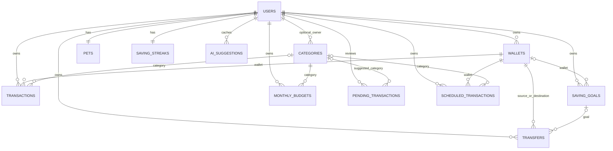
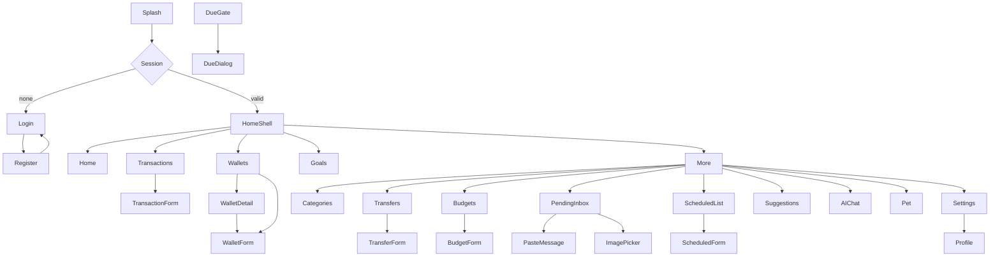
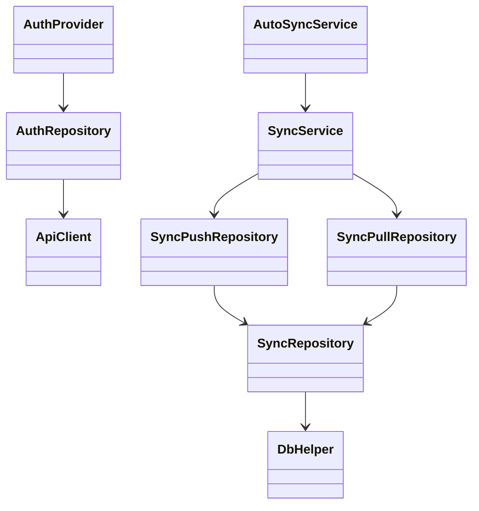
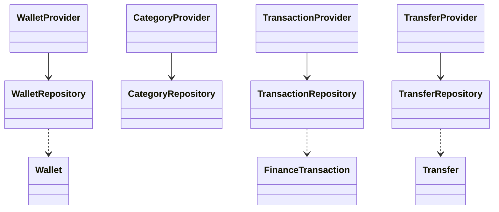
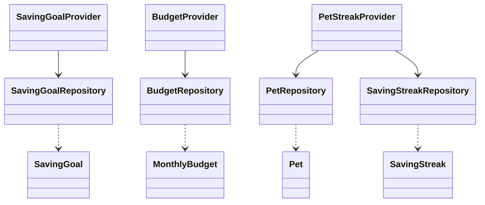
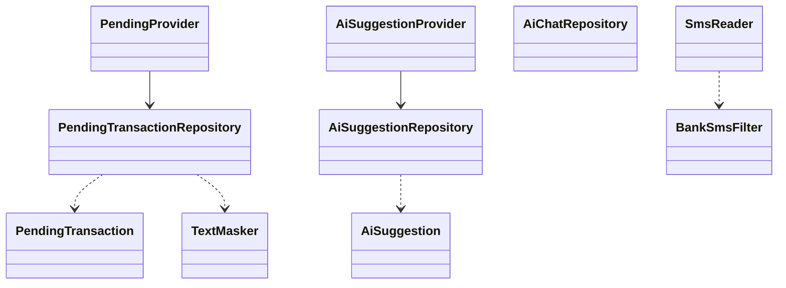
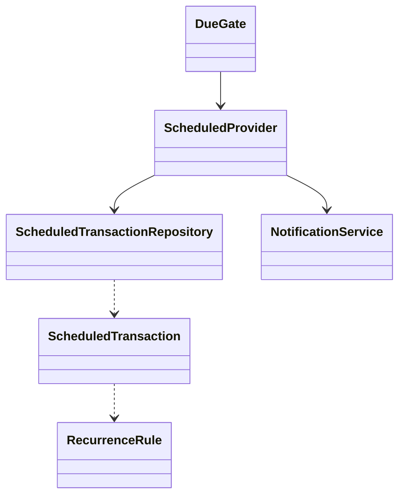

# Rà soát Frontend Flutter

> Phạm vi: `frontend/lib/`, `frontend/test/`, `pubspec.yaml`, `pubspec.lock`, `android/app`. Chỉ đọc source; tài liệu này không thay thế thiết kế giao diện. Dẫn chứng là repo-relative path và line. Không ghi credential/token.

## B1. Tổng quan kỹ thuật

Flutter SDK không được pin riêng; Dart constraint `>=3.3.0 <4.0.0` (`frontend/pubspec.yaml:6-7`). Version dependency dưới đây lấy từ `pubspec.lock`; phần file dùng là những import thực tế được rà soát, package có phạm vi rộng được đánh dấu.

| Package | Lock version | Vai trò / vị trí sử dụng |
|---|---:|---|
| `provider` | 6.1.5+1 | State/DI; `lib/app.dart`, `lib/providers/`, screens |
| `go_router` | 14.8.1 | Router/guard; `lib/routes/app_router.dart`, screens |
| `sqflite` | 2.4.4 | SQLite; `lib/core/database/db_helper.dart`, repositories |
| `path` | 1.9.1 | Tạo path DB; `db_helper.dart` |
| `path_provider` | 2.1.6 | Platform path/transitive platform support; dùng trong platform dependencies |
| `uuid` | 4.6.0 | ID local; repositories/utils |
| `intl` | 0.19.0 | Format ngày/tiền; `core/utils/formatters.dart`, screens |
| `http` | 1.6.0 | Được khai báo nhưng code đang dùng Dio; import package:http trong lib: KHÔNG TÌM THẤY theo `rg` |
| `dio` | 5.11.1 | HTTP/API; `core/network/api_client.dart`, AI/sync repositories |
| `crypto` | 3.0.7 | SHA-256 local password/hash; `auth_repository.dart`, `text_masker.dart` |
| `shared_preferences` | 2.5.3 | Token/session/cursor; auth/sync repositories |
| `fl_chart` | 0.68.0 | Dashboard charts; `screens/home/home_screen.dart` |
| `flutter_sms_inbox` | 1.0.5 | Đọc inbox Android; `core/sms/sms_reader.dart` |
| `permission_handler` | 13.0.2 | SMS/notification/permission; `sms_reader.dart`, notification/screens |
| `image_picker` | 1.2.4 | Camera/gallery; pending inbox |
| `flutter_local_notifications` | 22.3.3 | Scheduled reminders; `core/notifications/notification_service.dart` |
| `timezone` | 0.11.2 | Lịch nhắc giờ VN; notification service |
| `cupertino_icons` | 1.0.9 | Icon asset |
| `flutter_test` | SDK | Test framework |
| `flutter_lints` | 4.0.0 | Analyzer rules |
| `sqflite_common_ffi` | 2.4.4 | SQLite tests |

Constraint khai báo: `frontend/pubspec.yaml:6-7`; dependency declarations `:9-50`; lock versions tại `frontend/pubspec.lock` các package tương ứng. Routing thực tế dùng GoRouter (`routes/app_router.dart:2,36-38`), state management dùng Provider/MultiProvider/ChangeNotifierProxyProvider (`app.dart:4,160-278`), không chỉ là dependency khai báo.

Android: `applicationId`/namespace `com.example.do_an_flutter`; compileSdk 37; minSdk/targetSdk lấy Flutter plugin (`flutter.minSdkVersion`, `flutter.targetSdkVersion`), số hiệu hiệu lực không hardcode ở module (`android/app/build.gradle.kts:7-31`). AGP 9.1.0, Kotlin 2.4.0 (`android/settings.gradle.kts`); Gradle 9.3.1 (`android/gradle/wrapper/gradle-wrapper.properties`). Java/Kotlin target 17 và core desugaring `desugar_jdk_libs:2.1.5` (`app/build.gradle.kts:11-18,38-40`). Manifest permission: INTERNET, READ_SMS, POST_NOTIFICATIONS, RECEIVE_BOOT_COMPLETED, VIBRATE, USE_EXACT_ALARM, SCHEDULE_EXACT_ALARM maxSdk32; receivers scheduled notification và boot receiver; query intent IMAGE_CAPTURE; usesCleartextTraffic=true (`android/app/src/main/AndroidManifest.xml`). MainActivity là FlutterActivity, không có custom camera intent (`android/app/src/main/kotlin/com/example/do_an_flutter/MainActivity.kt:1-5`). API base URL dùng `String.fromEnvironment('API_BASE_URL', defaultValue:'http://10.0.2.2:8080')`, override `--dart-define` (`core/network/api_endpoints.dart:21-25`); đây là địa chỉ dev HTTP, manifest cho phép cleartext.

## B2. Khởi động, DI và điều hướng

`main()` gọi `WidgetsFlutterBinding.ensureInitialized` → mở `DbHelper.instance.database` → `ApiClient.loadToken()` → `NotificationService.init()` → `runApp(App(database))` (`lib/main.dart:6-12`). `App` tạo AuthRepository/AuthProvider và gọi bootstrap, một database dùng chung, SyncPush/Pull/Service và AutoSync; gắn `onLoggedIn=_pullAfterLogin`, local-change hook, unauthorized hook, app lifecycle resume (`lib/app.dart:43-107`). `_pullAfterLogin` đặt cursor 0 khi chưa có wallet, gọi syncAll; lỗi không chặn đăng nhập (`:140-150`). `onUnauthorized` đánh dấu cần login lại và hiện SnackBar (`:110-120`).

`MultiProvider` khai báo repositories bằng Provider; AuthProvider/AutoSync là ChangeNotifier; per-user providers là ChangeNotifierProxyProvider phụ thuộc AuthProvider và được recreate/load khi user đổi (`app.dart:160-278`). WalletProvider được update user; nhóm khác tạo repository qua context. `_noUser='_none_'` chỉ placeholder trước login (`app.dart:36-39`).

Route table (mọi route ở `lib/routes/app_router.dart:36-`):

| Path/name constant | Screen | Params/query | Guard/redirect |
|---|---|---|---|
| `/splash` | SplashScreen | — | auth unknown → splash |
| `/login`, `/register` | LoginScreen, RegisterScreen | — | unauthenticated được ở lại; auth chuyển home |
| `/home?tab=n` | HomeShell | tab query int, default 0 | auth required; wallet empty chuyển required |
| `/wallets` | HomeShell tab2 | — | same |
| `/wallets/add`, `/wallets/required`, `/wallets/:id/edit`, `/wallets/:id` | WalletForm/Detail | id path; required bool | authenticated + wallet policy |
| `/categories`, `/categories/add`, `/categories/:id/edit` | CategoryList/Form | id | auth |
| `/transactions` | HomeShell tab1 | — | auth |
| `/transactions/add`, `/transactions/:id/edit` | TransactionForm | id | auth |
| `/transfers`, `/transfers/add?goalId=` | TransferList/Form | goalId query | auth |
| `/saving-goals`, `/saving-goals/add`, `/saving-goals/:id` | HomeShell tab3, GoalForm/Detail | id | auth |
| `/budgets`, `/budgets/add` | BudgetList/Form | — | auth |
| `/pet`, `/ai-suggestions`, `/ai-chat` | Pet/AiSuggestion/AiChat | — | auth |
| `/pending`, `/pending/paste?fromInbox=true` | PendingInbox/PasteMessage | query | auth |
| `/scheduled`, `/scheduled/add`, `/scheduled/:id/edit` | ScheduledList/Form | id | auth |
| `/settings`, `/profile` | Settings/Profile | — | auth |

Redirect checks auth unknown/unauthenticated, no-wallet onboarding, wallet restored, splash/login/register to home (`app_router.dart:36-66`). Path constants: `core/constants/app_routes.dart`.

## B3. SQLite local

Database `personal_finance.db`, schema version 6; foreign_keys ON (`core/database/db_helper.dart:65-88`). Upgrade history: `<2` add wallets.opening_balance and reconstruct from cached balance/ledger (`:90-105`); `<3` normalize old +7h timestamps to UTC and dedupe active budgets, newest updated_at/id wins (`:106-140`); `<4` add transaction.source, pending_transactions, normalize email (`:141-147`); `<5` recreate ai_suggestions (`:148-164`); `<6` add scheduled_transactions (`:165-168`). Indexes `ux_budget_active`, tx wallet/user_date, transfer source/dest/goal, pending user/status, scheduled due (`:171-189`).

| Bảng | Cột/khóa/ràng buộc tổng quát | Phân loại |
|---|---|---|
| users | id PK, full_name/password_hash NOT NULL; email UNIQUE; monthly_income nullable; created_at DEFAULT CURRENT_TIMESTAMP; deleted DEFAULT 0 | Local auth, mirrored to backend users |
| wallets | id PK, user_id FK; name/type; current_balance DEFAULT 0; opening_balance NOT NULL DEFAULT 0; updated_at; deleted DEFAULT 0 | synced |
| categories | id PK; user_id nullable FK; category_name/type; CHECK type INCOME/EXPENSE; deleted | synced; seeded system categories |
| transactions | id PK; user/wallet FK; category nullable FK; type CHECK; amount>0; source default MANUAL CHECK; date; created/updated; deleted | synced |
| saving_goals | id PK; user/wallet FK; goal_name,target,saved_amount default0,expected date,status default IN_PROGRESS,updated,deleted | synced; saved_amount derived locally, not server field |
| transfers | id PK; user/source wallet/destination wallet/goal FK; amount>0,date,note,updated,deleted | synced |
| monthly_budgets | id PK; user/category FK; month,limit,updated,deleted | synced; unique active user/category/month index |
| pets | id PK; user UNIQUE FK; pet_name default Mam Nho, level default1, experience_points default0, shape default MEDIUM, updated | local-only |
| saving_streaks | id PK; user UNIQUE FK; current/longest default0,last_saved_date,updated | local-only |
| ai_suggestions | id PK; user FK; period_type CHECK WEEK/MONTH; period dates/content/data/created; UNIQUE user/type/start | local cache; AI server response cache |
| sync_queue | id PK; table_name,record_id; action CHECK CREATE/UPDATE/DELETE; is_synced default0; created default CURRENT_TIMESTAMP | client-only queue, never synced as a record |
| pending_transactions | id PK; user FK; source CHECK SMS/IMAGE/TEXT; masked content, parsed fields, source_hash; status CHECK NEEDS_AI/PENDING/CONFIRMED/REJECTED; UNIQUE user/source_hash; category FK | client-only workflow |
| scheduled_transactions | id PK; user/wallet/category FK; type CHECK; amount>0; dates/time/repeat fields; CHECK repeat unit/every pair; deleted | synced; migration backend V3 |

DDL field-by-field evidence: `db_helper.dart:194-360`, pending/scheduled DDL `:35-63`; constraints/indexes above `:171-188`. SQLite uses dynamic `TEXT/INTEGER/REAL`; nullable follows absence of NOT NULL, defaults as named. Indexes are listed explicitly above. ERD:

`sync_queue` has no FK to record tables by design in DDL. SQLite/backend differences (backend `backend/src/main/resources/db/migration/V1__init.sql`, V3): local wallets has `current_balance`, server does not; goals has `saved_amount`, server does not; local-only pets/streaks/AI/pending/sync_queue absent server; backend sync tables have `server_version`, absent locally (owned by server); server amount checks mirror some local checks; SQLite type affinity/text dates versus SQL Server typed UUID/DATE/DATETIME2; backend users email/password length and monthly_income. System categories seeded identically in SQLite and server V1; category IDs are in `db_helper.dart:24-33,367-433` and backend V1 lines 103-112.

## B4. Model

| Model | Trường/serialization |
|---|---|
| `AppUser` | id/fullName/email/passwordHash/monthlyIncome/timestamps/deleted; `toMap/fromMap`; `models/user.dart` |
| `Wallet` | id/userId/name/type/currentBalance/openingBalance/color/icon/updatedAt/deleted; `models/wallet.dart` |
| `TransactionCategory` | id/userId/name/type/color/icon/updatedAt/deleted; `models/category.dart` |
| `FinanceTransaction` | ids/type/amount/note/date/source/timestamps/deleted; `models/transaction.dart` |
| `Transfer` | ids source/destination/goal/amount/date/note/update/deleted; `models/transfer.dart` |
| `SavingGoal` | ids/name/target/saved/date/status/updated/deleted; `models/saving_goal.dart` |
| `MonthlyBudget` | ids/category/month/limit/update/deleted; `models/monthly_budget.dart` |
| `Pet`, `SavingStreak` | pet identity/name/level/xp/shape; streak counters/last date; respective models |
| `PendingTransaction` | source/raw-masked/parsed suggestion/hash/status; `models/pending_transaction.dart` |
| `AiSuggestion` | period/cache/content/data; `models/ai_suggestion.dart` |
| `ScheduledTransaction` | wallet/category/type/amount/start/time/repeat/end/nextDue/deleted; includes `RecurrenceRule`; `models/scheduled_transaction.dart` |
| `SyncQueueItem` | id/tableName/recordId/action/isSynced/createdAt; `models/sync_queue_item.dart` |

Các model chứa conversion SQLite `toMap/fromMap`; method signatures và enum/string conversions nằm trong từng file `frontend/lib/models/*.dart`. Relationship thực tế qua *_id FK DDL ở B3; một số models không khai báo object association.

## B5. Repository và Provider

| Repository | Chức năng/ghi bảng/enqueue |
|---|---|
| `AuthRepository` | local-first account, password SHA-256, SharedPreferences current user/token; users; khi online có auth endpoint |
| `WalletRepository` | CRUD, derived balance, soft-delete cascade qua transfers/transactions/goals/scheduled; enqueue mỗi record synced (`wallet_repository.dart`) |
| `CategoryRepository` | CRUD/soft delete, unassign dependent category and enqueue (`category_repository.dart`) |
| `TransactionRepository` | CRUD/filter/sum, validate references/amount/date; enqueue (`transaction_repository.dart`) |
| `TransferRepository` | tạo transfer, validate wallet/balance and same wallet; enqueue (`transfer_repository.dart`) |
| `SavingGoalRepository` | CRUD/progress/transfer contributions; enqueue goal/transfer (`saving_goal_repository.dart`) |
| `BudgetRepository` | validate month/limit, unique active budget; enqueue (`budget_repository.dart`) |
| `PetRepository`, `SavingStreakRepository` | local derived pet XP/level and streak, no sync_queue direct |
| `PendingTransactionRepository` | AI parse lifecycle and confirm/reject, local queue table; confirmation calls transaction repo |
| `ScheduledTransactionRepository` | CRUD/occurrence due recalculation; enqueue scheduled changes |
| `AiSuggestionRepository`, `AiChatRepository` | remote AI calls/cache and in-memory chat |
| `SyncRepository` | enqueue, snapshot, cursor, apply pulled, reconciliation |
| `SyncPushRepository`, `SyncPullRepository`, `SyncService` | HTTP push/pull and conflict/application |
| `AutoSyncService` | debounced/lifecycle/retry coordination |
| Providers | `AuthProvider`, Wallet/Category/Transaction/Transfer/SavingGoal/Budget/PetStreak/Pending/Scheduled/AiSuggestion providers wrap repository state and notify listeners. |

Exact selected business rules: wallet balance derived as `opening_balance + income - expenses - outgoing transfers + incoming transfers` (upgrade SQL at `db_helper.dart:95-104`; recompute `repositories/wallet_repository.dart`). Transfer repository rejects amount<=0, same source/destination, future date, invalid ownership, and amount greater than recomputed source balance (`repositories/transfer_repository.dart:26-42`). Soft deletes set flag plus updated_at and enqueue tombstones; wallet cascade marks related tx/transfer/goal/scheduled and enqueues them (`wallet_repository.dart:107-150`). Goal progress derives saved_amount from transfers associated to goal, displayed ratio clamps 0..1 (`repositories/derived_recompute.dart`; `models/saving_goal.dart:55`). Budget thresholds: safe <75%; warning at >=75% and <=100%; exceeded >100%; limit<=0 special case (`core/utils/budget_status.dart:17-36`). Saving streak uses distinct qualifying savings-transfer dates; consecutive calendar days increment by 1, current survives if last save is today or yesterday, longest tracks max (`repositories/saving_streak_repository.dart:26-68`). XP = 15 per qualifying savings transfer-date + 5 per active transaction; level starts at 1 and each next threshold is `level*100` XP; shape small <5, medium 5-9, large >=10 (`saving_streak_repository.dart:68-77`; `pet_repository.dart:26-45`). `derived_recompute` recomputes all active wallet balances, goal saved amounts, and streak/XP (`repositories/derived_recompute.dart:7-34`).

## B6. Sync phía client

`sync_queue` columns and enqueue semantics in `db_helper.dart:347-357`; `SyncRepository.enqueue/enqueueMany` coalesce queue by table+record, and local mutation hook signals auto sync (`repositories/sync_repository.dart:119-155`). Push creates snapshot from current DB record (not queued historical payload); batches up to backend batch cap in `SyncPushRepository` (implementation file). Client handles APPLIED by mark synced/remove queue; SKIPPED_NEWER via pull/reconcile; REJECTED FUTURE_DATE adjusts date/re-enqueues, PARENT_DELETED/INVALID local conflict policy (`SyncPushRepository`, `SyncService` comments e.g. `sync_service.dart:32`). Pull cursor stored per user in sync_queue/local prefs helper, paginates until has_more; detects CURSOR_STUCK (`sync_pull_repository.dart:28-80`); applies LWW and `reconcileAfterPull` via SyncRepository/derived recompute.

`SyncService.syncAll` push then pull, with FUTURE_DATE repair retry (`sync_service.dart`). `AutoSyncService`: local write debounce 3s; resume gap 30s; failure retry starts 5s then backoff list; explicit immediate request settings, unauthorized state, pending count/last sync exposed (`auto_sync_service.dart:15-16,41-73,121,150-168`). Triggered by local-change callback, app resume, auth transition; `app.dart:88-107,120-135`. HTTP 401 calls `ApiClient.onUnauthorized`; relogin needed. Login is online-first with offline hash fallback in AuthRepository; after login callback attempts sync but errors do not block login (`auth_repository.dart`, `app.dart:140-150`).

## B7. AI phía client

Pending states in local CHECK include NEEDS_AI/PENDING/CONFIRMED/REJECTED; FAILED is a result/state in provider/repo but not accepted by DB CHECK—code appears to leave failed records NEEDS_AI for retry (`db_helper.dart:43`; `pending_transaction_repository.dart` comment around status handling). Dedupe hash unique `(user_id,source_hash)`. Text normalized trim, whitespace collapse, lowercase + user id, SHA-256 (`core/utils/text_masker.dart:26-30`); image hash uses user id + `IMG` + compressed bytes (`:32-34`). Sends max ten NEEDS_AI per parse request; Dio receive timeout 60s (`pending_transaction_repository.dart:114-162`). Offline keeps pending locally.

Text masking exact regex: balance labels SD/số dư/so du/balance/bal plus amount; long digits >=9; spaced card four groups 4; spaced VN phone `+?84|0` with grouped digits (`text_masker.dart:10-24`). SMS permission status/request are explicit `SmsReader.status/request`; user action invoked from pending inbox (not startup); reads inbox max300 messages, recent 30 days and sorts newest (`sms_reader.dart:22-48`). Filter requires amount+currency, transaction keyword list; excludes OTP/auth keywords (`bank_sms_filter.dart:5-25`). Manifest READ_SMS (`AndroidManifest.xml`).

Image route is user-selected camera/gallery from bottom sheet; picker compression parameters and consent prompt in `screens/pending/pending_inbox_screen.dart`; image bytes hashed and not stored as binary (pending row masked_content `[Ảnh]`, `pending_transaction_repository.dart` image parser lines 381-395). Exact compression setting: see screen source; large evidence citation omitted here: `CHƯA XÁC MINH` exact numeric parameters. Consent dialog before upload is present in that screen. AI suggestion repository calls sync before request, timeouts/caching keyed user+period; `AiPeriod.next` and SuggestStatus in `models/ai_suggestion.dart`,`repositories/ai_suggestion_repository.dart`,`providers/ai_suggestion_provider.dart`. Chat repo/provider keeps messages in memory/UI, no chat-session table (models/repository sources); server max message rules in backend. Exact timeout/cache rules should be verified at referenced implementation.

## B8. Giao dịch định kỳ

`ScheduledTransaction` model stores repeat unit DAY/WEEK/MONTH/YEAR, every, end_date, next_due_date (`models/scheduled_transaction.dart`). `RecurrenceRule.dateAt(k)` derives every occurrence from original start (avoids month drift), clamps month days; nextAfter returns first strictly later date and checks end_date (`core/utils/occurrence.dart:22-89`). `DueGate` triggers DueDialog for due occurrences (`core/scheduled/due_gate.dart`); ScheduledProvider loads/recomputes, confirm creates transaction and advances schedule (`providers/scheduled_provider.dart`). DueDialog supports confirm/cancel and amount override (`screens/scheduled/due_dialog.dart`). Notification channel `scheduled_tx`, label “Giao dịch hẹn trước”; timezone Asia/Ho_Chi_Minh; exact alarm permission; at most 5 notifications per item and 100 total; skips already due, rebuilds on reschedule (`core/notifications/notification_service.dart:13-26,35-63,89-130`). Android boot receiver handles boot/package replaced. Cascade on wallet delete includes schedules (`wallet_repository.dart`).

## B9. Màn hình/URD inventory

| Screen/file | Route | Mục đích/controls/actions | Data/state/navigation |
|---|---|---|---|
| SplashScreen | `/splash` | Bootstrap status | auth/router redirects login/home |
| LoginScreen, RegisterScreen | `/login`,`/register` | form, validation, submit | AuthProvider; snackbar errors; switch routes |
| HomeShell/HomeScreen | `/home` | bottom tabs, quick actions, charts/recent | multiple providers; links to forms/details |
| WalletList/Detail/Form | `/wallets*` | list, balance/history, create/edit/delete | Wallet/Transaction providers; delete dialog; detail/edit |
| CategoryList/Form | `/categories*` | categories CRUD | CategoryProvider; form errors/snackbar |
| TransactionList/Form | `/transactions*` | ledger list/form | Transaction/Wallet/Category providers; edit route |
| TransferList/Form | `/transfers*` | internal transfer | Transfer/Wallet; insufficient balance validation |
| SavingGoal list/detail/form | `/saving-goals*` | goal progress/contribution | SavingGoal/Transfer; transfer form for goal |
| BudgetList/Form | `/budgets*` | month budgets/status | BudgetProvider; form limit/category |
| PetScreen | `/pet` | pet name/level | PetStreakProvider; rename dialog |
| PendingInbox/PasteMessage | `/pending*` | review AI drafts, SMS scan, image parse, paste | PendingProvider; image-source sheet, consent/review dialogs |
| AiSuggestionScreen/AiChatScreen | `/ai-suggestions`,`/ai-chat` | financial advice/chat | AI providers; loading/empty/error states |
| ScheduledList/Form/DueDialog | `/scheduled*` + modal | create/edit recurring, due confirmation | ScheduledProvider; amount edit/cancel/confirm |
| Settings/Profile | `/settings`,`/profile` | sync now, settings/profile | AutoSync/Auth; dialogs/snackbars |

All route-to-screen bindings at `lib/routes/app_router.dart`; controls/state exact widgets reside in listed screen files. Empty/loading/error states are not identical across screens; per-screen validation strings should be read from `FormState.validator` in each source. Screen flow:

Screenshot capture checklist (use data-seeded local account; avoid real SMS/private financial data):

1. Login screen: fresh launch signed out → `/login`.
2. Register validation: open register, submit empty/invalid fields.
3. Home populated: sign in to seeded account with transactions, charts and recent list.
4. Home empty: account with no transactions.
5. Transaction list populated and empty; create/edit form validation; use Transactions tab then add.
6. Wallet list/detail populated; wallet create/edit validation; More/Wallets then add/detail.
7. Wallet deletion confirm/countdown dialog and completion SnackBar; select delete on wallet detail/list.
8. Transfer form validation and successful transfer; More/Transfers.
9. Category list/form and validation; More/Categories.
10. Goals list/detail/form, progress and contribute transfer; Home goals tab.
11. Budget list statuses safe/warning/exceeded and form validation; More/Budgets.
12. Pending inbox populated, empty, reject confirmation, review/edit draft; More/Pending.
13. SMS permission granted/denied and scan results; tap scan explicitly; use test device SMS fixtures.
14. Image source bottom sheet (camera/gallery), image consent dialog, gallery parse success/error; Pending inbox.
15. Paste message form empty/invalid, AI loading/result/error; pending paste action.
16. AI suggestions insufficient/loading/result/error; More/Suggestions, vary seeded transaction history/network.
17. Chat empty/conversation/AI failure; More/AI chat.
18. Scheduled list/form validation, recurrence choices; More/Scheduled.
19. DueDialog due item, amount override, cancel/confirm; seed schedule due and resume/open app.
20. Notification permission rationale/system prompt, scheduled notification visible, tap action; Settings test notification.
21. Pet screen/name dialog; More/Pet.
22. Settings sync idle/running/success/failure/401 relogin SnackBar and reset cursor confirm; More/Settings.
23. Profile form save validation/success; Settings/Profile.

## B10. Class inventory / diagrams

| Layer | Main classes | Key dependencies |
|---|---|---|
| Screen | screen classes in B9 | Provider reads, GoRouter navigation |
| Provider | Auth/Wallet/Category/Transaction/Transfer/SavingGoal/Budget/PetStreak/Pending/Scheduled/AiSuggestion/AutoSync | corresponding repo/services, ChangeNotifier |
| Repository | repositories listed B5 | SQLite Database, ApiClient/Dio, SyncRepository |
| Model | models listed B4 | enum/value serializers |
| Service | SyncService, AutoSyncService, NotificationService, SmsReader | push/pull, lifecycle, plugins |
| Util | TextMasker, BankSmsFilter, RecurrenceRule, BudgetStatus, DerivedRecompute, Validators, Formatters | crypto/clock/model helpers |

Class/field/method full inventory would exceed a useful static summary; principal signatures are public methods in named source files. Relations below only show direct dependency/extends/interface seen in construction/imports.

## B11. Chuỗi gọi Sequence phía client

| Luồng | Chuỗi chính và nhánh |
|---|---|
| Register/login | Auth screen → AuthProvider → AuthRepository → API online; lỗi mạng → local SHA-256 user DB/SharedPreferences; login success callback → sync pull. |
| Tạo giao dịch | TransactionForm → TransactionProvider.create → TransactionRepository validation/transaction → SQLite + enqueue → local-change callback → AutoSync debounce. |
| Chuyển ví | TransferForm → TransferProvider → TransferRepository balance/reference validation → SQLite transfer + enqueue → refresh derived balances. Thiếu tiền alt lỗi UI. |
| Xóa ví cascade | Wallet list/detail → WalletDeleteDialog → WalletProvider/WalletRepository transaction → soft-delete children + enqueue snapshots → router handles no wallets. |
| Nạp goal | Goal detail → Transfer form (goalId) → TransferRepository → transfer linked goal → derived recompute/progress. |
| Cập nhật budget | BudgetForm → BudgetProvider → BudgetRepository validate month/limit/upsert → enqueue → reload. |
| Paste → review | Paste screen → PendingProvider → PendingTransactionRepository mask/hash/insert → Gemini batch → update pending → inbox review; offline/error leaves retryable. |
| SMS scan | Inbox explicit action → SmsReader permission/status → query latest 300/30 days → BankSmsFilter → PendingProvider dedupe/insert → parse endpoint. |
| Ảnh | Inbox → image source bottom sheet → consent → ImagePicker compressed bytes → hash → API parse-image → pending draft; error alt status. |
| Suggestions | Screen/provider → repository `syncAll` → API suggestion with period → local cache keyed user/period/start; timeout/error shown. |
| Chat | Chat screen → AiChatRepository → ApiClient/Dio; messages kept in current provider/UI, no session table located. |
| Scheduled create | ScheduledForm → ScheduledProvider → ScheduledTransactionRepository → SQLite+enqueue → reschedule notifications. |
| Due confirmation | DueGate → DueDialog → ScheduledProvider.confirm(amount override?) → transaction repo + advance occurrence → notifications rescheduled. |
| Sync now | Settings → AutoSyncService.request(immediate) → SyncService.syncAll → push snapshots/pull pages → apply LWW/reconcile → refresh providers/status. |
| AutoSync | local change/resume/auth transition → debounce/throttle/backoff → sync; 401 sets needs-relogin; network failure retries. |

Evidence screen source paths named in B9; provider/repo/service implementations are `frontend/lib/providers/`, `repositories/`, `core/`.

## B12. Kiểm thử frontend

| Test file | Số test | Chức năng |
|---|---:|---|
| `ai_suggestion_screen_test.dart` | 7 | suggestions states |
| `auto_sync_service_test.dart` | 3 | debounce/retry |
| `budget_status_bar_test.dart` | 6 | budget status UI |
| `image_helpers_test.dart` | 2 | image helpers |
| `pending_screens_test.dart` | 10 | pending UI |
| `recurrence_rule_test.dart` | 5 | recurrence |
| `scheduled_screens_test.dart` | 9 | scheduled UI |
| `sync_repository_test.dart` | 10 | queue/apply sync |
| `text_masker_test.dart` | 7 | mask/hash |
| `transaction_flow_test.dart` | 1 | transaction UI |
| `wallet_delete_dialog_test.dart` | 4 | delete dialog |
| `wallet_flow_test.dart` | 3 | wallet flow |
| `widget_test.dart` | 3 | smoke |

Số method trong bảng đếm occurrences `test(` và `testWidgets(` tại mỗi file; tổng theo source là 70, chưa phải số test pass.

Kết quả người dùng chạy thủ công trong `frontend/`:

| Lệnh | Kết quả |
|---|---|
| `flutter analyze` | 3 issues, đều mức `info` là `curly_braces_in_flow_control_structures`; tại `lib/providers/ai_suggestion_provider.dart:61,63,68`. Không có error/warning được liệt kê. Thời gian 18.7s. |
| `flutter test` | 70 tests passed; không có failure; elapsed hiển thị 9s. |

Lần gọi trong môi trường audit không xuất output sau khoảng 60 giây nên đã dừng; kết quả trên là lần chạy thủ công của người dùng và được dùng làm kết quả xác nhận cuối.

## B13. Số liệu

| Chỉ tiêu | Kết quả |
|---|---:|
| `.dart` trong `lib/` | 103 |
| `.dart` trong `test/` | 13 |
| Screens | 30 screen files; 32 GoRoute declarations (một số route reuse HomeShell) |
| Providers | 12 Dart files |
| Repositories | 19 |
| Models | 13 |
| LOC nonblank | lib 13,570; test 2,427 (whitespace-only lines excluded) |

Đếm file theo cây `frontend/lib`/`test`; class count theo package providers/repositories/models (đếm Dart files, không phải mọi inner class). Dẫn chứng là package trees tương ứng.

## B14. Giới hạn, TODO, code chết, debug

Đã xác định TODO trong `android/app/build.gradle.kts` về applicationId và release signing (`:20`, `:36`). HTTP dependency `http` còn khai báo nhưng import `package:http` không tìm thấy trong lib/test; code dùng Dio (`pubspec.yaml`, `core/network/api_client.dart`). Manifest `usesCleartextTraffic=true` cho phép HTTP (`AndroidManifest.xml`). App API endpoints header comment nói “nothing ... except SyncRepository deliberately stubbed”, nhưng hiện Auth/AI repos có API call; đây là comment/tài liệu stale, xem `core/network/api_endpoints.dart:1-4` và `repositories/auth_repository.dart`, `ai_*_repository.dart`. Tile debug: `MaterialApp.router(debugShowCheckedModeBanner:false)` (`app.dart`); debugPrint logs còn trong NotificationService scheduled notification (`notification_service.dart:43-45,129`) và cần đánh giá có nhạy cảm payload không. Tổng code chết chưa phân tích static: CHƯA XÁC MINH.

## Lệch giữa code và tài liệu

1. `api_endpoints.dart:1-4` nói chỉ SyncRepository gọi endpoint/những repository còn stub, nhưng `AuthRepository` và AI repositories thực hiện Dio calls; code thực tế là nguồn sự thật.
2. `pubspec.yaml` chú thích GoRouter là “future” nhưng GoRouter được instantiate và dùng guard thật (`routes/app_router.dart:36-66`).
3. Manifest cho `usesCleartextTraffic=true`; cần đối chiếu tiêu chuẩn release/deployment docs nếu tài liệu nói chỉ HTTPS.
4. Mobile server contract: SQLite có `current_balance`, `saved_amount`, Pet/Streak và pending/cache local-only; backend migration không có các cột/bảng này. Chi tiết mapping A4 backend report và B3 ở đây.

## B15. Câu hỏi và điểm mơ hồ

1. Ba analyzer info tại `ai_suggestion_provider.dart:61,63,68` là style lints, không chặn build; có muốn giữ nguyên hay chuẩn hóa block braces trong lần sửa code sau không? (Ngoài phạm vi chỉ đọc của audit này.)
2. `minSdk`/`targetSdk` được lấy từ Flutter plugin, không khai báo số cụ thể trong app module; cần output `flutter doctor -v`/Gradle resolved config để xác nhận nếu báo cáo cần số.
3. Cần xác minh chính xác Pet XP/level, saving streak formula và AiSuggestion cache/timeout values từ các repository nếu cần đưa mọi hằng số vào báo cáo.
4. Cần kiểm tra image_picker compression parameters và full catalog validation per form; tài liệu này chỉ ghi luồng đã xác định.
5. Số test method và LOC chưa được đo theo từng file/toàn bộ source; không suy ra từ số file.
6. Cần xác nhận những bảng local-only có kế hoạch đồng bộ sau này hay thuộc thiết kế cuối cùng.
