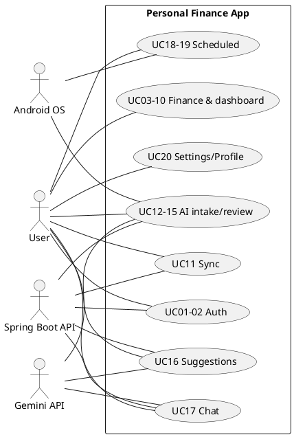

# Rà soát xuyên suốt frontend + backend

> Snapshot code đang checkout tại 05/11/2026. Tài liệu tạo từ source, docs, test reports và Git history. Mọi URL/credential nhạy cảm được lược bỏ. Dẫn chứng repo-relative.

## C1. Use case

### Actor và danh mục

Actors xác định từ tích hợp code: **User**; **Android OS** (SMS permission/inbox, camera/gallery picker, notification permission/boot/alarm); **Spring Boot API** (client gọi REST); **Gemini API** (backend `GeminiHttpClient`). Không có actor/admin riêng trong source được rà soát. Bằng chứng: `frontend/lib/core/sms/sms_reader.dart:1-4,22-35`; `frontend/lib/screens/pending/pending_inbox_screen.dart` (image picker); `frontend/lib/core/notifications/notification_service.dart:35-63`; `backend/src/main/java/com/pfm/backend/ai/GeminiHttpClient.java:91-118`.

| ID | Module/use case | Actor | Screen/API tham gia |
|---|---|---|---|
| UC01 | Auth: đăng ký | User, Spring Boot API | `screens/auth/register_screen.dart`; `AuthRepository.register`; `POST /auth/register` |
| UC02 | Auth: đăng nhập online/offline | User, API | `login_screen.dart`; `AuthRepository.login/_loginOffline`; `/auth/login` |
| UC03 | Wallet: tạo/sửa/xem/xóa | User | Wallet screens; `WalletProvider/WalletRepository` |
| UC04 | Category: CRUD | User | Category screens; `CategoryRepository` |
| UC05 | Transaction: tạo/sửa/xóa/lọc | User | transaction screens; `TransactionRepository`; `GET /transactions` backend |
| UC06 | Transfer: chuyển giữa ví | User | transfer screens; `TransferRepository` |
| UC07 | Saving Goal: tạo/xem/đóng góp | User | goal screens; `SavingGoalRepository` |
| UC08 | Budget: đặt/xem ngân sách | User | budget screens; `BudgetRepository` |
| UC09 | Dashboard: xem tổng quan | User | `home/home_screen.dart`, `HomeProvider` dependencies |
| UC10 | Pet/Streak: xem tiến độ/đổi tên pet | User | `pet_screen.dart`; `PetStreakProvider` |
| UC11 | Sync: đồng bộ ngay/auto | User, Spring Boot API | settings; `AutoSyncService`, `SyncService`; `/sync/push`,`/sync/pull` |
| UC12 | AI Parse Text: dán nội dung | User, API, Gemini API | `paste_message_screen.dart`; `PendingTransactionRepository`; `/ai/parse-text` |
| UC13 | SMS: quét inbox | User, Android OS | pending inbox; `SmsReader`, `BankSmsFilter`; sau đó UC12 |
| UC14 | AI Parse Image: receipt/message | User, Android OS, API, Gemini API | pending inbox; `/ai/parse-image` |
| UC15 | Pending Inbox: duyệt/từ chối draft | User | `pending_inbox_screen.dart`; `PendingProvider`, repository |
| UC16 | AI Suggestions | User, API, Gemini API | suggestion screen/provider; `/ai/suggestions` |
| UC17 | AI Chat | User, API, Gemini API | chat screen/repository; `/ai/chat` |
| UC18 | Scheduled: tạo/sửa/xóa lịch | User | scheduled screens/provider/repo |
| UC19 | Scheduled: xử lý đến hạn | User, Android OS | `DueGate`, `DueDialog`, NotificationService |
| UC20 | Settings/Profile | User | settings/profile screens; AuthProvider/AutoSyncService |

Bằng chứng route-screen mapping: `frontend/lib/routes/app_router.dart` (buildRouter); UI files đúng tên trong bảng; service route mappings ở `backend/src/main/java/com/pfm/backend/{auth/AuthController,sync/SyncController,transaction/TransactionController,ai/AiController}.java`.

### PlantUML tổng quát



### Module diagrams

```plantuml
@startuml
actor User
rectangle Auth { usecase "UC01 Register" as A; usecase "UC02 Login" as B }
User -- A
User -- B
@enduml
```

```plantuml
@startuml
actor User
rectangle Wallet { usecase "UC03 Create/edit/view/delete wallet" as A }
User -- A
@enduml
```

```plantuml
@startuml
actor User
rectangle Category { usecase "UC04 Maintain categories" as A }
User -- A
@enduml
```

```plantuml
@startuml
actor User
rectangle Transaction { usecase "UC05 Maintain/search transactions" as A }
User -- A
@enduml
```

```plantuml
@startuml
actor User
rectangle Transfer { usecase "UC06 Transfer between wallets" as A }
User -- A
@enduml
```

```plantuml
@startuml
actor User
rectangle "Saving Goal" { usecase "UC07 Manage goal and contributions" as A }
User -- A
@enduml
```

```plantuml
@startuml
actor User
rectangle Budget { usecase "UC08 Set/view monthly budget" as A }
User -- A
@enduml
```

```plantuml
@startuml
actor User
rectangle Dashboard { usecase "UC09 View dashboard" as A }
User -- A
@enduml
```

```plantuml
@startuml
actor User
rectangle "Pet/Streak" { usecase "UC10 View streak and pet" as A }
User -- A
@enduml
```

```plantuml
@startuml
actor User
actor "Spring Boot API" as API
rectangle Sync { usecase "UC11 Sync now/automatically" as A }
User -- A
API -- A
@enduml
```

```plantuml
@startuml
actor User
actor "Spring Boot API" as API
actor "Gemini API" as G
rectangle "AI Parse Text" { usecase "UC12 Parse pasted text" as A; usecase "UC15 Review draft" as B }
User -- A
User -- B
API -- A
G -- A
A ..> B : creates draft for
@enduml
```

```plantuml
@startuml
actor User
actor "Android OS" as OS
rectangle SMS { usecase "UC13 Request permission and scan" as A }
User -- A
OS -- A
@enduml
```

```plantuml
@startuml
actor User
actor "Android OS" as OS
actor "Spring Boot API" as API
actor "Gemini API" as G
rectangle "AI Parse Image" { usecase "UC14 Select/parse receipt image" as A; usecase "UC15 Review draft" as B }
User -- A
OS -- A
API -- A
G -- A
A ..> B : creates draft for
@enduml
```

```plantuml
@startuml
actor User
rectangle "Pending Inbox" { usecase "UC15 Confirm/reject AI draft" as A }
User -- A
@enduml
```

```plantuml
@startuml
actor User
actor "Spring Boot API" as API
actor "Gemini API" as G
rectangle "AI Suggestions" { usecase "UC16 Request spending advice" as A }
User -- A
API -- A
G -- A
@enduml
```

```plantuml
@startuml
actor User
actor "Spring Boot API" as API
actor "Gemini API" as G
rectangle "AI Chat" { usecase "UC17 Ask financial question" as A }
User -- A
API -- A
G -- A
@enduml
```

```plantuml
@startuml
actor User
rectangle "Scheduled Transaction" { usecase "UC18 Create/edit schedule" as A }
User -- A
@enduml
```

```plantuml
@startuml
actor User
actor "Android OS" as OS
rectangle "Scheduled Due" { usecase "UC19 Receive reminder and confirm/cancel" as A }
User -- A
OS -- A
@enduml
```

```plantuml
@startuml
actor User
rectangle Settings { usecase "UC20 Manage profile/sync settings" as A }
User -- A
@enduml
```

Các module diagrams chỉ thể hiện actor–goal. Không thêm include/extend ngoài quan hệ AI tạo draft → duyệt được thể hiện bởi code; widget dialogs là bước UI, không có UML include/extend declaration trong source.

### Đặc tả use case chính

| UC | Tiền điều kiện | Luồng chính | Thay thế/ngoại lệ | Hậu điều kiện và quy tắc |
|---|---|---|---|---|
| UC02 Login | Có account; online hoặc local record | LoginScreen → AuthProvider → AuthRepository POST `/auth/login`; token/session lưu; callback pull | NetworkException → local SHA256 check; invalid credential → thông báo lỗi; unauthorized sync → yêu cầu đăng nhập lại | `current_user_id`; online token lưu; pull lỗi không chặn login. `AuthRepository.login/_loginOffline`; `App._pullAfterLogin` |
| UC05 Tạo transaction | Authenticated local user, wallet hợp lệ | Form validate → provider → transaction repo → SQLite transaction + queue → recompute → auto sync | Invalid amount/ref/future date → throw/error UI; offline vẫn local | Transaction tạo locally; server sync sau. `TransactionRepository.create`; `SyncRepository.enqueue` |
| UC06 Tạo transfer | Hai ví thuộc user; amount>0; source funds đủ | Form → provider → repo checks → insert transfer/queue → recalc balance/goal/streak | source=destination/future/insufficient funds/goal rule fail | Transfer không là income/expense; `TransferRepository.create` |
| UC11 Sync | Login + token, network, server available | SyncService push dirty snapshots, process results, then pull cursor pages/apply and recompute | no token; network; 401; REJECTED; FUTURE_DATE repair retry; push error stops pull | DB applied, cursor advances after commit; `SyncService.syncAll`, push/pull repos |
| UC12/15 Paste and review | User signed in; text present | PasteScreen → mask/hash/store → send batch parse → pending draft → user edits/confirms → TransactionRepository.create | offline: pending remains NEEDS_AI; parse errors/retry; reject draft | AI output never directly writes transaction; confirm atomic with pending status. `PendingTransactionRepository.addText/confirm` |
| UC13 Scan SMS | Android SMS permission granted after explicit user action | request/status → read inbox recent 300/30d → filter amount+keyword and exclude OTP → dedupe/store → parse | permission denied/permanently denied; no matching SMS; offline retains items | Does not auto-monitor background SMS. `SmsReader`, `BankSmsFilter`, `PendingProvider.scan` |
| UC14 Parse image | User selected image, consents, network/token | camera/gallery → compress → consent → hash → parse-image → pending draft | cancel selection/consent; 401/429/503/network; duplicate hash | Stores `[Ảnh]`/hash, not image binary; transaction only after confirm. `PendingInboxScreen`, `PendingTransactionRepository.addImage/confirm` |
| UC16 Suggestions | JWT, selected period | provider syncAll then repo requests; stores result by period | insufficient data/offline/401/rate limit/unavailable/busy | AI response cached, does not mutate ledger/balance. `AiSuggestionProvider`, `AiSuggestionRepository.requestSuggestion` |
| UC17 Chat | JWT, messages; backend has >=5 tx in 3 months | screen → AiChatRepository → `/ai/chat` → backend aggregates → Gemini reply | insufficient data, timeout/offline/401/429/503 | Session in client memory/UI; backend no chat persistence. `AiChatRepository`, `AiChatService.chat` |
| UC18/19 Scheduled | User/wallet; recurrence valid | Form saves schedule, queues sync, reschedules notification; due gate presents dialog; confirm amount optionally edited | cancel occurrence, no permissions, notification failure, expired schedule | Confirm creates transaction and advances nextDue; `ScheduledProvider.confirm`, `Occurrence.nextAfter` |
| UC03 Delete wallet | User owns wallet; explicit confirmation | Delete dialog → repository txn soft-delete parent/children, enqueue snapshots, derived recompute | dialog cancelled; route redirects if last wallet | Soft delete; no hard delete. `WalletDeleteDialog`, `WalletRepository.delete` |

## C2. Sequence diagram xuyên suốt

### 1. Đăng ký
```mermaid
sequenceDiagram
 actor U as User
 participant S as RegisterScreen
 participant P as AuthProvider
 participant R as AuthRepository
 participant A as ApiClient
 participant B as AuthService
 participant DB as SQL Server
 U->>S: submit form
 S->>P: register(...)
 P->>R: register(...)
 R->>A: POST /auth/register
 A->>B: HTTP request
 B->>DB: check email/id, save user
 B-->>A: token + user
 A-->>R: response
 R->>R: create local user/pet/streak; save token/session
 R-->>P: AppUser
 P-->>S: authenticated
```
Evidence: `register_screen.dart`; `AuthProvider.register`; `AuthRepository.register/_createLocalUser`; `AuthController.register`; `AuthService.register`.

### 2. Đăng nhập online/fallback
```mermaid
sequenceDiagram
 actor U as User
 participant S as LoginScreen
 participant P as AuthProvider
 participant R as AuthRepository
 participant A as ApiClient
 participant B as AuthService
 participant DB as SQLite
 S->>P: login(email,password)
 P->>R: login(...)
 R->>A: POST /auth/login
 alt online success
  A->>B: authenticate
  B-->>A: JWT/user
  A-->>R: response
  R->>DB: upsert local user/session
 else NetworkException
  R->>DB: _loginOffline; compare SHA-256
 end
 R-->>P: AppUser
 P->>P: onLoggedIn(userId)
```
Evidence: `AuthRepository.login/_loginOffline`; `AuthProvider`; `App._pullAfterLogin`.

### 3. Tạo transaction offline
```mermaid
sequenceDiagram
 actor U as User
 participant S as TransactionFormScreen
 participant P as TransactionProvider
 participant R as TransactionRepository
 participant DB as SQLite
 participant Q as SyncRepository
 participant AS as AutoSyncService
 S->>P: create(...)
 P->>R: create(...)
 R->>DB: validate + insert in transaction
 R->>Q: enqueue(table,id,CREATE)
 Q->>DB: insert/coalesce sync_queue
 Q-->>AS: onLocalChange
 AS-->>AS: debounce 3s
```
Evidence: `TransactionFormScreen._save`; `TransactionProvider.create`; `TransactionRepository.create`; `SyncRepository.enqueue`; `App.initState`.

### 4. Sync push + pull / REJECTED
```mermaid
sequenceDiagram
 participant AS as AutoSyncService
 participant SS as SyncService
 participant PR as SyncPushRepository
 participant SR as SyncRepository
 participant API as Backend SyncController
 participant PS as SyncPushService
 participant PL as SyncPullRepository
 participant DB as SQLite
 AS->>SS: syncAll(userId)
 SS->>PR: push(userId)
 PR->>SR: buildPushBatch/splitBatch
 PR->>API: POST /sync/push
 API->>PS: push(uid,request)
 PS-->>API: APPLIED/SKIPPED_NEWER/REJECTED
 PR->>SR: markSynced/handleRejected
 alt push error or unauthorized
  SS-->>AS: error; no pull
 else push okay
  SS->>PL: pull(userId)
  PL->>API: GET /sync/pull(cursor,limit)
  API-->>PL: page(s)
  PL->>DB: applyPulled + reconcile + derived recompute
  PL->>SR: saveCursor after commit
 end
```
Evidence: `SyncService.syncAll`; `SyncPushRepository.push`; `SyncPullRepository.pull`; backend `SyncController`, `SyncPushService`, `SyncPullService`.

### 5. LWW conflict
```mermaid
sequenceDiagram
 participant C as Client A
 participant S as SyncPushService
 participant DB as SQL Server
 participant P as SyncPullService
 participant C2 as Client B
 C->>S: push id, updated_at=t1
 S->>DB: compare current.updated_at
 alt t1 newer
  S->>DB: apply + next server_version
 else t1 not newer
  S-->>C: SKIPPED_NEWER
 end
 C2->>P: pull(cursor)
 P->>DB: records server_version>cursor
 P-->>C2: changes
 C2->>C2: applyPulled timestamp LWW
```
Evidence: backend `SyncPushService.gate/stamp`; frontend `SyncRepository.applyPulled`.

### 6. Paste → parse-text → confirm
```mermaid
sequenceDiagram
 actor U as User
 participant S as PasteMessageScreen
 participant P as PendingProvider
 participant R as PendingTransactionRepository
 participant DB as SQLite
 participant API as AiController
 participant AI as GeminiHttpClient
 S->>P: submit text
 P->>R: addText
 R->>DB: mask/hash/insert NEEDS_AI
 opt token + network
  R->>API: POST /ai/parse-text
  API->>AI: generateJson
  AI-->>API: JSON result
  API-->>R: suggestion/status
  R->>DB: update pending draft
 end
 U->>P: confirm/edit draft
 P->>R: confirm
 R->>DB: transaction create + pending CONFIRMED atomically
```
Evidence: Paste screen, PendingProvider, `PendingTransactionRepository.addText/confirm`; backend `AiController.parseText`, `AiParseService.parse`.

### 7. SMS scan
```mermaid
sequenceDiagram
 actor U as User
 participant UI as PendingInboxScreen
 participant P as PendingProvider
 participant OS as Android OS
 participant R as SmsReader
 participant F as BankSmsFilter
 participant PR as PendingTransactionRepository
 UI->>P: scanSms (explicit action)
 P->>R: status/request permission
 R->>OS: READ_SMS request
 OS-->>R: permission status
 R->>OS: query inbox (max 300, 30 days)
 OS-->>R: RawSms list
 P->>F: looksLikeTransaction(body)
 F-->>P: filter matches
 P->>PR: dedupe/store pending
```
Evidence: `PendingProvider.scanSms`; `SmsReader`; `BankSmsFilter`; pending repo.

### 8. Parse image
```mermaid
sequenceDiagram
 actor U as User
 participant UI as PendingInboxScreen
 participant OS as Android OS
 participant P as PendingProvider
 participant R as PendingTransactionRepository
 participant API as AiController
 participant AI as GeminiHttpClient
 U->>UI: choose camera/gallery
 UI->>OS: ImagePicker.pickImage
 OS-->>UI: compressed file
 UI->>U: consent dialog
 U->>P: agree
 P->>R: addImage
 R->>API: POST /ai/parse-image
 API->>AI: image + prompt/schema
 AI-->>API: JSON
 API-->>R: suggestion
 R->>R: hash bytes; save draft, not binary
```
Evidence: `PendingInboxScreen._pickImage`; pending provider/repo; backend `AiParseService.parseImage`.

### 9. Suggestions
```mermaid
sequenceDiagram
 actor U as User
 participant UI as AiSuggestionScreen
 participant P as AiSuggestionProvider
 participant AS as AutoSyncService
 participant R as AiSuggestionRepository
 participant API as AiController
 participant AI as GeminiHttpClient
 UI->>P: load/request period
 P->>AS: syncNow
 P->>R: requestSuggestion
 R->>API: POST /ai/suggestions
 API->>AI: aggregate prompt/schema
 AI-->>API: JSON suggestions
 API-->>R: content/data/status
 R-->>P: cache/outcome
 P-->>UI: notify state
```
Evidence: `AiSuggestionProvider`, `AiSuggestionRepository.requestSuggestion`, `AiSuggestionService.suggest`.

### 10. Chat AI
```mermaid
sequenceDiagram
 actor U as User
 participant UI as AiChatScreen
 participant R as AiChatRepository
 participant API as AiController
 participant S as AiChatService
 participant DB as SQL Server
 participant AI as GeminiHttpClient
 U->>UI: send message
 UI->>R: send(messages)
 R->>API: POST /ai/chat
 API->>S: chat(userId,request)
 S->>DB: recent transactions/categories/budgets
 alt fewer than 5 transactions
  S-->>API: INSUFFICIENT_DATA
 else enough data
  S->>AI: aggregate + history/question
  AI-->>S: reply JSON
  S-->>API: OK reply
 end
 API-->>R: response
 R-->>UI: display
```
Evidence: `AiChatRepository.send`; `AiController.chat`; `AiChatService.chat`.

### 11. Scheduled: create → reminder → confirm
```mermaid
sequenceDiagram
 actor U as User
 participant UI as ScheduledFormScreen
 participant P as ScheduledProvider
 participant R as ScheduledTransactionRepository
 participant N as NotificationService
 participant G as DueGate
 participant D as DueDialog
 participant DB as SQLite
 UI->>P: save schedule
 P->>R: create/update
 R->>DB: save + enqueue
 P->>N: reschedule
 N-->>U: Android notification at due time
 G->>D: show due occurrence
 U->>D: confirm (optional amount)
 D->>P: confirm(occurrence,amount)
 P->>R: create transaction + advance nextDueDate
 R->>DB: commit + enqueue
```
Evidence: `ScheduledProvider`, `ScheduledTransactionRepository`, `NotificationService`, `DueGate`, `DueDialog`.

### 12. Delete wallet cascade
```mermaid
sequenceDiagram
 actor U as User
 participant UI as WalletDetailScreen
 participant D as WalletDeleteDialog
 participant P as WalletProvider
 participant R as WalletRepository
 participant DB as SQLite
 U->>D: confirm delete
 D->>P: delete(walletId)
 P->>R: delete(...)
 R->>DB: transaction soft-delete wallet + dependents
 R->>DB: enqueue child snapshots/tombstones
 R->>R: recompute derived values
 R-->>P: complete
 P-->>UI: refresh/routes
```
Evidence: wallet screen/dialog/provider/repository source.

### 13. AutoSync
```mermaid
sequenceDiagram
 participant Repo as Local Repository
 participant SR as SyncRepository
 participant AS as AutoSyncService
 participant SS as SyncService
 participant API as Backend API
 Repo->>SR: enqueue local mutation
 SR-->>AS: onLocalChange
 AS->>AS: debounce 3 seconds
 AS->>SS: syncAll(userId)
 SS->>API: push then pull
 alt 401
  API-->>AS: UNAUTHORIZED
  AS->>AS: needsRelogin=true
 else network error
  AS->>AS: retry 30/60/120/300s
 else success
  AS->>AS: save lastSyncAt; refresh providers
 end
```
Evidence: `SyncRepository.onLocalChange/enqueue`; `AutoSyncService.request/_afterSync/_scheduleRetry`; `App.initState/didChangeAppLifecycleState`.

## C3. Bảng quy tắc nghiệp vụ FE-BE

| Quy tắc | Phát biểu/FE | BE | Nhất quán |
|---|---|---|---|
| Wallet balance | `opening_balance + income - expense - transfer_out + transfer_in`; `WalletRepository.recomputeBalance` | Server không lưu current_balance; không tính số dư (`V1__init.sql`, `SyncPushService`) | Có, cache local |
| Transfer không vào thu/chi | Transfer riêng trong bảng `transfers`; `TransactionRepository` sums transactions | Backend chat/query thu/chi lấy transactions; transfers riêng | Có |
| Cấm ngày tương lai | `ensureNotFuture` transaction/transfer/scheduled confirm; repo methods | `SyncPushService` trả FUTURE_DATE với transaction/transfer dates; scheduled start future hợp lệ | Có, theo loại record |
| Soft delete | `is_deleted=1`, enqueue tombstone | `stamp(...,deleted)`; no hard delete push | Có |
| LWW UTC | timestamps ISO UTC; client pull compares updated_at | server compares updated_at, clamp +5m; UTC JPA config | Có về field; precision/clock skew residual |
| Unique budget | SQLite filtered unique user/category/month | SQL Server filtered unique same key | Có |
| Wallet cascade | WalletRepository soft deletes tx/transfers/goals/scheduled and enqueues | Không có delete-wallet endpoint; sync FK blocks invalid parents, child orphan policy | Client cascade; server behavior not equivalent direct cascade |
| Streak/XP | savings transfer dates; XP 15/date +5/active transaction; `SavingStreakRepository.recompute` | Không có pet/streak tables/services | Local-only |
| AI writes ledger | pending flow writes transaction only on user confirm | parse endpoints return suggestion only; no transaction write | Có |
| AI suggestion balance | cache in `ai_suggestions`; no ledger mutation | service computes data and returns only | Có |
| Dedupe source_hash | SHA256(userId|normalized text) / image bytes; unique user+hash | Backend parse does not persist pending/dedupe | Frontend-only |
| Mask sensitive data | `TextMasker`; backend `SensitiveMasker`; image itself sent to Gemini | backend additionally masks returned image note; parse text masks server input too | Partly; FE regex differs BE regex |
| userId body | FE pushes optional `user_id`; server requires match token; API userId derived JWT | `SyncPushService.gate`; controller uses JWT subject | Server enforces; FE omits or sends record ownership field |
| Ownership | FE repo checks owned wallet/category references | `SyncPushService` checks record and parent user ownership | Có, BE authoritative |
| Derived caches | current_balance/saved_amount recompute after writes/pull | columns absent on server | Có, client cache only |

Evidence: frontend `repositories/{wallet,transaction,transfer,saving_streak}_repository.dart`, `core/utils/text_masker.dart`, `repositories/sync_repository.dart`; backend `sync/SyncPushService.java`, `ai/AiParseService.java`, `ai/AiSuggestionService.java`; migrations V1/V3.

## C4. Yêu cầu phi chức năng có bằng chứng

| Thuộc tính | Thực thi/bằng chứng |
|---|---|
| Security | BCrypt backend; JWT HS256 7d, stateless; all non-public routes authenticated; token client in SharedPreferences (`SecurityConfig.java`, `JwtService.java`, `ApiClient`). Offline password hash SHA256 local (`AuthRepository._hash`) is not backend password scheme. |
| Privacy | Mask text before persistence/send (`TextMasker`); backend SensitiveMasker; image bytes sent to Gemini, local DB stores placeholder/hash; chat sends aggregate 3-month data/history/question, not notes/transfers/balances (`AiChatService`). |
| Offline-first | Local SQLite repositories; enqueue sync_queue; auth fallback login; AI/network-only functionality reports offline (`AuthRepository`, `SyncRepository`). |
| Performance | Push max 500, pull limit max500; transactions page max100; Android SMS read max300/30 days; indexes in V1-V3; AI HTTP connect5/read15s, client AI receive60s. |
| Failure handling | structured API errors; AutoSync retries 30/60/120/300s; stop on 401 and show re-login snackbar; parse statuses; test fake Gemini config. |
| Logging | Backend logs model/status and exception class; no prompt/image content in explicit log (`GeminiHttpClient`); frontend has debugPrint for notifications, sync rejection, refresh errors. Release log stripping policy: CHƯA XÁC MINH. |

## C5. Triển khai

### Runtime topology/config

| Component | Protocol/port/direction | Evidence |
|---|---|---|
| Android Flutter + SQLite | SQLite on-device; outbound HTTP(S) to API; default emulator host `10.0.2.2:8080` | `api_endpoints.dart:21-25`; `HUONG_DAN_CHAY_APP.md:13,121-124` |
| Spring Boot | HTTP localhost:8080; outbound JDBC SQL Server; outbound HTTPS Gemini API | `HUONG_DAN_CHAY_APP.md:105`; `application.yml`; `GeminiHttpClient` |
| SQL Server | TCP 1433 default local docs; database `pfm`/`pfm_test` via env URL | `HUONG_DAN_CHAY_APP.md:10,33-36` |
| Gemini API | HTTPS Generative Language API; backend only | `application.yml:28-30`; `GeminiHttpClient` |

Vars: `DB_URL`, `DB_USER`, `DB_PASSWORD`, `TEST_DB_URL`, `JWT_SECRET`, optional `GEMINI_API_KEY`, `GEMINI_MODEL`, `GEMINI_FALLBACK_MODEL`, build-time `API_BASE_URL`. `app.jwt.expires-days=7`, Gemini timeout 15 default; `application.yml` and `api_endpoints.dart`. Backend starts Flyway automatically at Spring application context startup because `spring.flyway.enabled: true`; migrations `backend/src/main/resources/db/migration/V1..V3`.

Run commands from repo/docs: `cd backend; .\mvnw.cmd spring-boot:run`; tests `.\mvnw.cmd test`. Flutter device with LAN IP: `flutter run --dart-define=API_BASE_URL=http://<LAN-IP>:8080` (`docs/HUONG_DAN_CHAY_APP.md:121-124`). To build APK based on project: `cd frontend; flutter build apk --dart-define=API_BASE_URL=http://<LAN-IP>:8080` (Flutter CLI command; exact release signing is not configured—`android/app/build.gradle.kts:32-37` uses debug signing). On physical device use host LAN IP, same network, allow port 8080 firewall (`HUONG_DAN_CHAY_APP.md:13,163`). Cleartext allowed in manifest, so HTTP config works; production HTTPS/release setup: CHƯA XÁC MINH.

```plantuml
@startuml
node "Android Device" {
 artifact "Flutter app"
 database "SQLite personal_finance.db"
 Flutter app --> SQLite : local reads/writes
}
node "Developer/Server Host" {
 artifact "Spring Boot backend :8080"
 database "SQL Server :1433"
 Spring Boot backend --> SQL Server : JDBC/TCP
}
cloud "Gemini Generative Language API" as Gemini
Flutter app --> "Spring Boot backend :8080" : HTTP(S) REST + JWT
Spring Boot backend --> Gemini : HTTPS + API key
@enduml
```

## C6. Tính nhất quán tài liệu

| Tài liệu | Nội dung lệch / code thực tế | Bên sai |
|---|---|---|
| `docs/api/openapi.yaml` | 9 routes phản ánh các controller. AI error responses 429/503 chưa được mô tả đồng đều; security global bearer áp dụng parse text/image vì không `security:[]` và backend yêu cầu auth. | Tài liệu thiếu một phần lỗi |
| `docs/SYNC_RULES.md` | Mô tả cursor/server_version, push statuses; source `SyncPullService` dùng cursor, không phải since timestamp. | Khớp |
| `docs/DB_Flutter_Idea.md` | Ghi rõ SQLite current_balance/saved_amount cache và các bảng local-only; backend migrations không có các cột/table này. Đây là phân tách có chủ ý theo chính tài liệu. | Khớp |
| `docs/PHASE2_SUMMARY.md` | Tóm tắt sync cursor và test method counts cũ có thể lệch số test hiện tại; lần chạy confirmed 54. Cần so đúng các dòng test table nếu dùng báo cáo. | CHƯA XÁC MINH mọi chi tiết |
| `docs/PHASE3_PLAN.md` | Là kế hoạch/đề xuất, không coi là trạng thái triển khai; code hiện parse text/image, suggestions, chat đều có. | Nếu ghi như trạng thái thì tài liệu stale |
| `frontend/PROJECT-STRUCTURE-FE.md` | Ghi GoRouter/state/sync/AI; GoRouter thực sự dùng; cây cấu trúc có thể thiếu files mới theo ngày snapshot. | Phần kiến trúc khớp; cây cần snapshot |
| `backend/PROJECT-STRUCTURE_BE.md` | Hiện liệt kê 9 APIs và security; phù hợp controller. | Khớp tổng thể |
| `docs/HUONG_DAN_CHAY_APP.md` | Hướng dẫn JDK17; `pom.xml` target Java17 nhưng lần chạy backend log Java runtime 25.0.4.1. Đây không mâu thuẫn target bytecode nhưng khác JDK runtime kỳ vọng. | Hướng dẫn/runtime environment khác |
| `pubspec.yaml` comments | GoRouter note có thể gọi route names “future REST” nhưng GoRouter hiện hoạt động thực tế; `api_endpoints.dart:1-4` nói chỉ SyncRepository gọi endpoints/stub repos, nhưng Auth/AI repo thực hiện API. | Code/comment tài liệu stale |
| SQLite vs SQL Server | SQLite có current_balance/saved_amount, pet/streak/cache/pending/queue; backend không có. Server có server_version, client không giữ field ở local row; cursor per-user SharedPreferences. | Thiết kế khác tầng, không nhất thiết lỗi |

Evidence: frontend `routes/app_router.dart`, `core/network/api_endpoints.dart`, `repositories/auth_repository.dart`, `ai_*_repository.dart`, `core/database/db_helper.dart`; backend controller/migrations; docs cited paths. OpenAPI version 3.1.0. Java target `backend/pom.xml:15-17`; runtime 25.0.4.1 was logged by Maven test on 05/11/2026.

## C7. Ma trận trạng thái tính năng

| Tính năng | Backend | Frontend | UI | Automated test | Ghi chú |
|---|---|---|---|---|---|
| Auth | AuthController/AuthService | AuthRepository/AuthProvider | login/register | AuthIntegrationTest; wallet flow auth fakes | backend online-first, offline login |
| Wallet | Server sync entity | wallet repo/provider | wallet screens | wallet_flow, wallet_delete_dialog, SyncIntegrationTest | server current_balance absent |
| Category | sync entity/repo | category repo/provider | category screens | SyncIntegrationTest | system categories seeded |
| Transaction | query/sync | tx repo/provider | tx list/form | TransactionSearchIntegrationTest; transaction_flow | API GET and sync |
| Transfer | sync entity/service | transfer repo/provider | transfer screens | SyncIntegrationTest | separate transfer table |
| Saving goal | sync entity/service | goal repo/provider | goal screens | SyncIntegrationTest | saved amount local cache |
| Budget | sync service | budget repo/provider | budget screens | SyncIntegrationTest; budget_status_bar_test | filtered unique active row |
| Dashboard | no separate API | local repositories/providers | home screen | widget_test | local derived calculations |
| Pet/Streak | absent server | pet/streak repos/providers | pet screen | KHÔNG TÌM THẤY dedicated test | local-only |
| Sync | push/pull | sync services | Settings/manual status | SyncIntegrationTest; sync_repository_test; auto_sync_service_test | server version cursor |
| Parse text | AI controller/service | pending repo/provider | paste + inbox | AiParseIntegrationTest, AiParseServiceTest, pending_screens_test | confirm creates transaction |
| SMS | absent backend SMS permission | SmsReader/filter/provider | pending inbox | pending_screens_test (SMS path coverage: CHƯA XÁC MINH) | Android-only |
| Parse image | AiController/AiParseService | pending repo/provider | camera/gallery inbox | AiParseImageIntegrationTest; image_helpers_test | user consent, no image storage |
| Suggestions | AiSuggestionService | repo/provider | suggestion screen | AiSuggestionIntegrationTest; ai_suggestion_screen_test | cache local |
| Chat | AiChatService | chat repo/provider | chat screen | AiChatIntegrationTest | backend no chat history table |
| Scheduled | scheduled sync entity | schedule repo/provider/notifications | scheduled screens + due dialog | ScheduledSyncIntegrationTest; scheduled_screens_test; recurrence_rule_test | OS alarms |
| Settings/Profile | no separate profile API | Auth/AutoSync | settings/profile | KHÔNG TÌM THẤY dedicated profile test | local profile update |

## C8. Kiểm thử và chạy thử

| Suite | Kết quả xác nhận |
|---|---|
| Backend `mvn test` (`backend/`) | 54 tests, 0 failures, 0 errors, 0 skipped; BUILD SUCCESS; 24.528s. User ran after loading local env config. Flyway validated 3 migrations/schema version 3. Credential/URL omitted. |
| `flutter analyze` (`frontend/`) | 3 issues, all info `curly_braces_in_flow_control_structures` at `lib/providers/ai_suggestion_provider.dart:61,63,68`; 18.7s. |
| `flutter test` (`frontend/`) | 70 passed; no failed tests; 9s as terminal summary. |

Backend automated cases → feature: `AuthIntegrationTest` auth; `SyncIntegrationTest` push/pull/LWW/ownership/future/parent reject; `ScheduledSyncIntegrationTest`; `TransactionSearchIntegrationTest`; `AiParseIntegrationTest`, `AiParseImageIntegrationTest`, `AiParseErrorIntegrationTest`, `AiSuggestionIntegrationTest`, `AiChatIntegrationTest`; `AiParseServiceTest`. Frontend cases map in `frontend/test/{wallet_flow_test,wallet_delete_dialog_test,transaction_flow_test,sync_repository_test,auto_sync_service_test,pending_screens_test,text_masker_test,image_helpers_test,ai_suggestion_screen_test,recurrence_rule_test,scheduled_screens_test,budget_status_bar_test}.` Test definitions/report from backend Surefire and user's Flutter CLI output.

Postman: no Postman collection file found by repository filename search. `docs/PHASE2_SUMMARY.md:143-194` contains manual Postman instructions and cases; counts are presented there, not a collection artifact. API examples also in `docs/api/openapi.yaml`.

## C9. Bảng công nghệ

| Công nghệ | Version thực tế | Dùng trong đồ án | Evidence |
|---|---|---|---|
| Flutter | SDK cài tại môi trường không pin ở repo; test runtime | UI Android/offline-first | `frontend/pubspec.yaml:6-7` |
| Dart | >=3.3.0 <4.0.0 | app language | `pubspec.yaml:6-7` |
| Provider | 6.1.5+1 | DI/state | `app.dart`, pubspec.lock |
| GoRouter | 14.8.1 | routing/guard | `routes/app_router.dart` |
| sqflite | 2.4.4 | SQLite | `db_helper.dart`, lock |
| Dio | 5.11.1 | HTTP client | `core/network/api_client.dart` |
| shared_preferences | 2.5.5 | token/session/cursor | auth/sync repos |
| fl_chart | 0.68.0 | dashboard charts | `home_screen.dart` |
| image_picker | 1.2.4 | camera/gallery | pending inbox |
| permission_handler | 13.0.2 | SMS/notification permission | SmsReader/NotificationService |
| flutter_sms_inbox | 1.0.5 | query SMS inbox | `sms_reader.dart` |
| flutter_local_notifications | 22.3.3 | scheduled alerts | NotificationService |
| timezone | 0.11.2 | VN time scheduling | NotificationService |
| Spring Boot | 4.1.1 | backend REST | `backend/pom.xml:5-9` |
| Spring Security | parent-managed 4.1.1 BOM | auth/resource server | pom/SecurityConfig |
| Spring Data JPA | parent-managed | persistence | pom/repositories |
| Hibernate ORM | test log 7.4.5.Final | JPA provider | Maven test log |
| Flyway | parent-managed + `flyway-sqlserver` | schema migrations | pom, migrations |
| JWT | Spring Security OAuth2 + Nimbus JOSE; no `jjwt` dependency | HS256 issue/decode | `JwtConfig`,`JwtService`; pom |
| springdoc | 3.1.1 | Swagger/OpenAPI | pom |
| SQL Server JDBC | 13.6.0.jre11 | SQL Server connectivity | pom |
| SQL Server | test DB log 16.0 | relational DB | Flyway/Hibernate startup log |
| Gemini | `GEMINI_MODEL` default `gemini-3.1-flash-lite`, fallback `gemini-3.5-flash-lite` | generative parse/advice/chat | `application.yml`, GeminiHttpClient |
| JUnit Jupiter / Spring test | parent-managed; Surefire 3.5.6 | test backend | pom/Surefire report |
| sqflite_common_ffi | 2.4.4 dev | SQLite test db | pubspec.lock/test |

Flutter package versions from `frontend/pubspec.lock`; runtime Flutter/Dart exact versions: CHƯA XÁC MINH (not pinned in repo; user's analyze output doesn't print SDK versions). Spring Boot actual 4.1.1. Java compile target 17; runtime test host logged Java25.0.4.1.

## C10. Git history

Snapshot `git branch --all`: **12 local branches**: `develop`, `feature/advanced-feature`, `feature/ai-feature`, `feature/be-auth-sync`, `feature/be-search-tests`, `feature/be-sync-pull`, `feature/chatting-ai`, `feature/fe-business-logic`, `feature/flutter-backend-sync`, `fix/auto-sync`, `fix/upgrade-ui-ux` (checked out), `main`. There are 4 remote branch refs (`origin/develop`, `origin/feature/be-auth-sync`, `origin/feature/fe-business-logic`, `origin/main`); `origin/HEAD` is a symbolic ref, not an extra branch. Total reachable commits across all refs: 37. `git shortlog -sn --all`: NamVo 36, namv999 1. `git log --all --merges`: no merge commits, so PR count cannot be derived; CHƯA XÁC MINH externally.

Major history milestones (`git log --all --date=short --pretty=format`): 25 Aug repo init; 8 Oct Flutter structure; 17-19 Oct business logic/UTC/migration v4; 20 Oct Spring Boot/Flyway/JWT; 22 Oct cursor pull/client sync; 24 Oct rejection and derived recompute; 26 Oct transaction search; 27-29 Oct Gemini/text/SMS; 1 Nov suggestions; 2 Nov image parsing; 4 Nov scheduled transactions; 5 Nov auto-sync and chat. Weekly commits by ISO week (37 reachable): 2026-W35:2, W41:7, W42:4, W43:13, W44:5, W45:6. Branch names from `git branch --all`; commit details via Git log. Note count of local branch names needs `git branch` (non-remote) to avoid alias ambiguity in display.

## C11. Hạn chế đã biết

| Hạn chế | Mức ảnh hưởng | Evidence |
|---|---|---|
| FE local SHA-256 password hash versus backend BCrypt | medium: offline credential hash not equivalent to server hash (they are separate records/uses) | `AuthRepository._hash`; `AuthService.register` |
| App manifest allows cleartext HTTP; default API URL is emulator HTTP | high for production transport security if shipped unchanged | `AndroidManifest.xml usesCleartextTraffic`; `ApiEndpoints.baseUrl` |
| Android release signing uses debug config and TODO remains | high for store/release readiness | `android/app/build.gradle.kts:32-37` |
| Fixed Gemini timeout/retry and provider rate limits | medium: AI request may report unavailable/rate-limited | `GeminiHttpClient`; client AI repos |
| Gemini receives compressed image and aggregate financial figures/chat history/question | privacy relevance; documented in A6 evidence | backend AI services; pending repo |
| Global sequence is allocated before commit; concurrent push ordering may have cursor visibility race | medium/high sync correctness risk; no lock/commit-order solution evidenced | `ServerVersionService.next`; `SyncPullService.pull` |
| Suggestions/chat/parse require network; chat needs >=5 transactions; offline UI can only show unavailable/pending | medium feature availability | AI repos and `AiChatService` |
| SMS access requires sensitive Android permission and explicit scan; target/Play distribution implications not assessed | medium privacy/distribution | Manifest, `SmsReader` |
| SQL Server hard deletes blocked by default FK; application uses soft deletes | operational retention/data cleanup impact | V1/V3 FK DDL, repositories |
| Three analyzer info issues remain | low, style only | user `flutter analyze`: ai_suggestion_provider.dart lines 61,63,68 |
| JDK docs say 17 while tested runtime was 25; compile target remains 17 | low reproducibility uncertainty | `pom.xml`; Maven test logs; `HUONG_DAN_CHAY_APP.md` |
| Some repo comments/docs still say only SyncRepository calls API though Auth/AI use API | low documentation maintenance | `api_endpoints.dart:1-4`; auth/AI repositories |

## C12. Câu hỏi và điểm mơ hồ

1. Exact PR count requires hosting metadata because no merge commits exist in local Git history.
2. Runtime Flutter/Dart exact versions need `flutter --version`; not pinned in repo.
3. Production HTTPS endpoint, backend host/container orchestration, SQL Server production topology, backup policy and release signing are not described by the checked-in implementation: CHƯA XÁC MINH.
4. The deployment PlantUML reflects developer guide/dev runtime, not production infrastructure.
5. The current line-level test results are reliable from user-provided CLI output and Maven Surefire; no new tests were launched during this cross-cutting read-only audit.
# Khôi phục mật khẩu bằng OTP

Backend gửi OTP 6 chữ số qua Gmail, chỉ lưu BCrypt hash, hết hạn sau 10 phút, tối đa 5 lần nhập sai và giới hạn gửi lại 60 giây. Endpoint không xác nhận email chưa đăng ký; gửi mail lỗi sẽ xóa OTP để người dùng thử lại. Flutter có màn hình gửi mã và đổi mật khẩu, đồng thời đồng bộ hash SHA-256 cục bộ sau khi server xác nhận thành công. Cấu hình Gmail bằng `MAIL_USERNAME` và `MAIL_PASSWORD` trong `backend/env-local.ps1`; tuyệt đối không ghi App Password vào mã nguồn hoặc báo cáo.

Giới hạn: JWT đã cấp trước đó vẫn có hiệu lực đến khi hết hạn; chỉ có thể reset email đã đăng ký và đồng bộ trên backend. Mã `OTP_TOO_SOON` chỉ xuất hiện với tài khoản có thật nên tiết lộ nhẹ trạng thái đăng ký; yêu cầu email không tồn tại cũng có thể trả lời nhanh hơn do không gửi SMTP.
